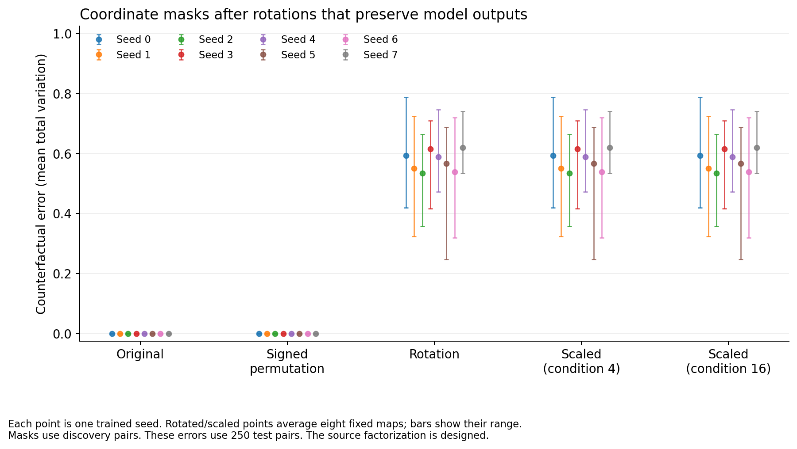
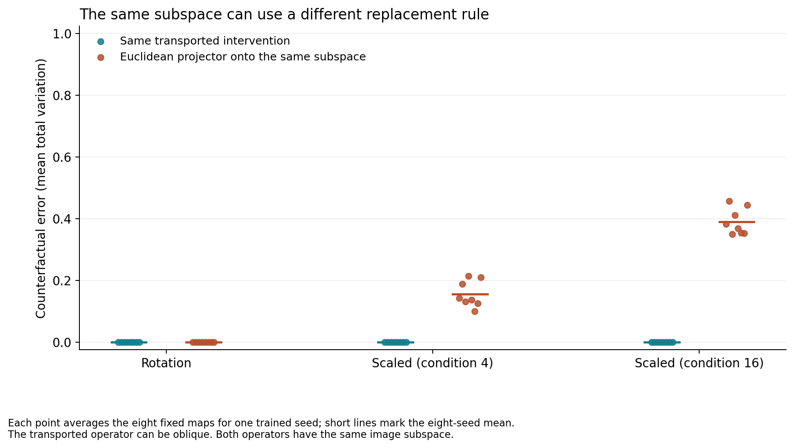

# The same subspace can specify different interventions

*A controlled audit of coordinate masks and transported activation patches*

13 October 2026 · Reproducible synthetic experiment · AI-assisted research

## Abstract

A change to a network’s internal coordinates can leave every normal answer unchanged but alter what an activation patch does. We tested this distinction in eight small trained networks. Each network had a known separation between two input variables. After random rotations, a discovery-selected four-coordinate patch gave the correct counterfactual answer on 43.7% of test pairs, compared with 100% in the original coordinates. The correctly transformed intervention kept 100% accuracy. We then stretched the rotated coordinates. An ordinary Euclidean projection onto the same transformed subspace gave 85.1% accuracy at condition number 4 and 62.4% at condition number 16. The correct intervention still gave 100%. The coordinate-mask outputs stayed unchanged under this stretching, as the algebra predicts. Thus the experiment separates a change in the available coordinate masks from a change in the replacement rule. The architecture supplies the known separation. The contribution is a complete numerical audit, not a new claim that coordinates matter, a new theorem, or a method for discovering mechanisms in language models.

## 1. The question

A **coordinate** is one numbered entry in an internal vector. An activation patch replaces some internal information from one input, called the receiver, with information from another input, called the donor. An **intervention operator** is the rule that makes this replacement.

These terms refer to different choices. Selecting four entries of an eight-entry vector gives one rule. Selecting a four-dimensional subspace gives a set of possible directions, but does not always specify which other directions to leave unchanged. This distinction matters when a change of coordinates stretches the space as well as rotating it.

We asked two questions. First, how does a rotation affect the best patch selected from a fixed family of coordinate masks? Second, when the coordinates are also stretched, does a Euclidean projection onto the transformed subspace implement the same intervention?

Our answers concern a constructed, small setting with a known factorization. The model’s structure separates the two source variables before they enter a shared decoder. This design supplies an exact control. It does not show that a general trained model has the same separation.

## 2. What earlier work establishes

The dependence of unit interpretation on the basis is established. Bau et al. rotated hidden representations and compensated the downstream computation in *Network Dissection*. The normal predictions were preserved while unit interpretability changed. Our rotation comparison does not introduce that principle. [Bau et al., 2017](https://openaccess.thecvf.com/content_cvpr_2017/papers/Bau_Network_Dissection_Quantifying_CVPR_2017_paper.pdf).

Distributed alignment search already finds causal alignments in non-standard bases and uses subspace interchange interventions. In this study the correct operator is known from the construction. It is an oracle control, not a new competitor to alignment search. [Geiger et al., 2024](https://proceedings.mlr.press/v236/geiger24a.html).

The permitted transformations also depend on the model architecture and its nonlinear functions. We apply the change at an explicit linear interface. We do not rotate through a tanh operation or claim that a dense rotation preserves the separate-branch parameter constraint. [Godfrey et al., 2022/2023](https://arxiv.org/abs/2205.14258).

Superposition research distinguishes features from individual neurons. Our transformations are invertible and preserve all eight dimensions. This experiment does not test compression or the packing of more features into fewer dimensions. [Elhage et al., 2022](https://arxiv.org/abs/2209.10652).

Successful patches can also give misleading evidence about the mechanism used in normal execution. Exact transport only proves that two descriptions give the same intervention. It does not prove that an intervention discovered in another model identifies its normal mechanism. The recent October 2026 work on objective-level recovery gaps provides a further reason to distinguish a good patch score from mechanism recovery. [Makelov, Lange, and Nanda, 2023](https://arxiv.org/abs/2311.17030); [Geng et al., 2026](https://arxiv.org/html/2610.02098v1).

Our specific contribution is the controlled audit: all coordinate masks, a signed-permutation check, a known transported operator, and a non-orthogonal comparison that keeps the coordinate-mask family fixed. The algebra below is standard change-of-coordinates algebra.

## 3. A task with a supplied causal separation

Each input contains two numbers, a and b, from 0 to 4. The target is the ordered pair

\[
((a+b)\bmod 5,\;b).
\]

The second answer component exposes unwanted copying of the donor’s b. There are 25 input states and 25 answer classes. All states occur in ordinary training. The network can memorize this table; the experiment does not establish that it learns an arithmetic algorithm.

A trainable linear branch maps a to four entries. A second branch maps b to four entries. Their concatenation gives eight entries. A fixed linear interface, initially the identity, connects these branches to a decoder with 32 tanh units and a 25-class softmax output. The trainable branches and decoder use full-batch Adam for 4,000 steps. Seeds 0–7, the initialization, and all training settings were fixed before the run. All eight models obtained 25 out of 25 correct normal answers.

In the original coordinates, replacing the first four entries changes only a. It produces exactly the internal state for `(donor a, receiver b)`. This is a consequence of the architecture. It holds even before training.

We used all 500 ordered receiver–donor pairs whose a values differ. A fixed hash order assigned 250 pairs to discovery and 250 to test. The discovery set had 55 pairs with matching b values; the test set had 45. Thus 205 test pairs could expose unwanted donor-b effects. This split holds out pairings, not task states.

For each coordinate system, we tested every four-entry mask: 70 candidates. We selected the candidate with the smallest discovery error. Values within 10^-12 of the minimum used a fixed lexicographic tie rule. We then evaluated the selected mask on test pairs. Test results did not select the masks or the transformations.

The primary error is **total variation distance** between the patched output distribution and the intact model’s distribution for `(donor a, receiver b)`:

\[
\operatorname{TV}(p,q)=\tfrac12\sum_c|p_c-q_c|.
\]

It ranges from 0 to 1; lower is better. It compares full answer distributions, not just their most likely class. We also report the percentage of patches with the correct counterfactual class.

## 4. Keeping the intervention the same

We used 26 coordinate systems: the original system; one fixed permutation with sign changes; eight fixed random orthogonal matrices; and two stretched versions of each rotation. The random matrices were fixed before training and shared across model seeds.

Write internal states as row vectors. A coordinate change is `z′ = zT`. Multiplying the decoder’s first weight matrix by `T^-1` on the left keeps the normal network function unchanged. The coordinate map is at the linear interface, before the decoder’s tanh operation.

Let P select the original a branch. The native patch is

\[
z_r+(z_d-z_r)P.
\]

To keep this intervention unchanged in the new coordinates, use

\[
P_T=T^{-1}PT.
\]

Then

\[
z_rT+(z_dT-z_rT)P_T
=\left[z_r+(z_d-z_r)P\right]T.
\]

The compensated decoder therefore gives the same patched answer distribution. This identity is an exact specification for the implementation checks.

For an orthogonal transformation, the transported operator is an orthogonal projector. For a general invertible transformation it can be **oblique**: it selects the same target subspace but leaves a different complementary subspace unchanged from the one chosen by Euclidean projection.

To test this distinction, we formed `T = QD`, where Q is one of the fixed rotations. D stretches the coordinates with positive diagonal values. Their largest-to-smallest ratio, the condition number, was either 4 or 16. These are designed test conditions, not estimated properties of a language model.

We compared the transported operator with E, the Euclidean orthogonal projector onto the row span of the first four rows of T. Both have the same image subspace. Their rules for ignoring other directions can differ.

This construction has another exact control. A diagonal coordinate mask commutes with D. Therefore each coordinate-mask intervention must have the same output under Q and QD. Stretching changes the Euclidean image-projector comparison while leaving all 70 coordinate candidates unchanged.

## 5. Results

The model’s normal answers remained unchanged in every coordinate system. The maximum absolute change in a class probability was 2.25 × 10^-20. The maximum difference between native and correctly transported patch probabilities was 3.39 × 10^-20. These are numerical checks of exact identities, not estimates of an uncertain scientific effect.

The main results are below. Each value first averages the eight fixed transformations within a model seed where applicable, then gives equal weight to all eight model seeds. “Near zero” means less than 10^-18 here.

| Coordinates and patch rule | Mean test TV | Correct counterfactual class |
|---|---:|---:|
| Original coordinates: selected four-entry mask | Near zero | 100.00% |
| Signed permutation: selected four-entry mask | Near zero | 100.00% |
| Rotation: selected four-entry mask | 0.5759 | 43.73% |
| Rotation: transported operator | Near zero | 100.00% |
| Rotation: Euclidean image projector | Near zero | 100.00% |
| Rotation plus stretching, condition 4: transported operator | Near zero | 100.00% |
| Rotation plus stretching, condition 4: Euclidean image projector | 0.1559 | 85.14% |
| Rotation plus stretching, condition 16: transported operator | Near zero | 100.00% |
| Rotation plus stretching, condition 16: Euclidean image projector | 0.3902 | 62.40% |

The rotation result varied across trained models and coordinate maps. The eight per-seed mean TV values ranged from 0.5335 to 0.6197. Across all 64 model–rotation combinations, selected-mask TV ranged from 0.2467 to 0.7877. These combinations are repeated conditions on eight models, not 64 independent training runs.

The signed-permutation check tested all 70 candidates after relabeling the coordinates, not just the winning mask. Its largest probability difference was 2.00 × 10^-15. The diagonal-scaling check also tested every candidate. Its largest difference was 6.11 × 10^-15. Thus the repeated coordinate-mask values in the stretched conditions are expected and verified.

For the Euclidean projector, per-seed mean TV ranged from 0.1002 to 0.2135 at condition 4, and from 0.3502 to 0.4573 at condition 16. Correct transport stayed at numerical zero throughout.

The b-matched pairs provide a further check. On these pairs, the donor changes only the a branch. The Euclidean projector then reproduces the counterfactual even in the stretched coordinates, up to numerical error. Its error appears on pairs where b also changes. On the 205 such test pairs, mean TV was 0.1901 at condition 4 and 0.4758 at condition 16. This is consistent with the difference in the operators’ complementary subspaces.

## 6. What the audit supports

First, counting the same number of coordinates does not preserve the set of candidate interventions. A signed permutation preserves this set after relabeling. A general rotation changes it. An exhaustive search over 70 masks is exhaustive only within the chosen coordinate system.

Second, a subspace and a replacement rule are not interchangeable under a general change of coordinates. A method that specifies only the image subspace can omit the rule for retaining the other information. Orthogonal transformations hide this distinction because the transported projector stays orthogonal. The stretching test makes it visible.

Third, an exact transport residual is useful for diagnosis. A large residual would indicate a problem in the coordinate transformation or patch implementation. A small residual, combined with changed coordinate-mask scores, instead points to a changed candidate family. In this experiment, the exact controls passed and the selected coordinate masks still performed poorly after rotation.

For a practical audit, save the full intervention operator and the coordinate map. Check normal outputs, transported patch outputs, and any relabeling that should preserve the candidate family. If a method uses Euclidean projection after a non-orthogonal map, state that geometric choice explicitly. It defines a valid intervention, but it need not preserve the original one.

## 7. Limits

The native basis is favorable by construction. The known intervention is built into two source branches. We do not infer an unknown mechanism from behavior, and we do not claim that the native basis is a natural or unique basis for arbitrary networks.

The task is finite and fully observed during normal training. The held-out evidence concerns new receiver–donor pairings among known states. There is no result about unseen arithmetic inputs, language tasks, large models, or how frequently these errors occur in practice.

The transported operator also has information unavailable to a discovery method: the true branch projector and the exact coordinate map. Its success does not establish that it can be found from data. Comparing equal ranks does not remove that advantage.

Finally, an orthogonal projector is appropriate when the intended rule uses the Euclidean geometry of the current coordinates. Our result does not make such projectors universally wrong. It shows why preserving a previous intervention through a non-orthogonal coordinate map requires the full operator, or an equivalent change to the geometric rule.

## Reproduction and review

The [analysis plan](analysis-plan.md) and experiment runner were published before training in commit [`d4ca99a`](https://github.com/gavenren/mechanistic-interpretability-research/commit/d4ca99ae08121070facd5ff755b6ca4b164dc304). The runner checked their exact contents before and after execution. This is a repository analysis lock, not a third-party registration. The experiment took 18.9 seconds on the local CPU, excluding later review and plotting. No model seed was replaced and no training setting was changed after results were seen.

The [README](README.md) gives reproduction steps. The repository includes all eight weight files, all 26 coordinate maps, the 500-pair ledger, all 29,120 candidate-score rows, selected masks, operator comparisons, and file hashes. The [summary](results/summary.json) and [per-seed table](results/per-seed-summary.csv) support the reported values. The [source record](sources.md) gives the literature boundary.

This study was produced with AI assistance. A separate AI agent checked the methods, paper, and figures. Its independent audit recomputed all 29,120 candidate-score rows, 208 selected masks, and 1,664 operator rows from saved weights. Across 122,560,962 compared values, the largest absolute difference was 7.11 × 10^-15; all 30 scientific-file hashes matched. See the [review record](reviews/independent-review.md) for the calculation scope. The audit did not repeat training. No human peer review has been recorded. The paper reports a reproducible controlled example, with bounded claims about that example.
