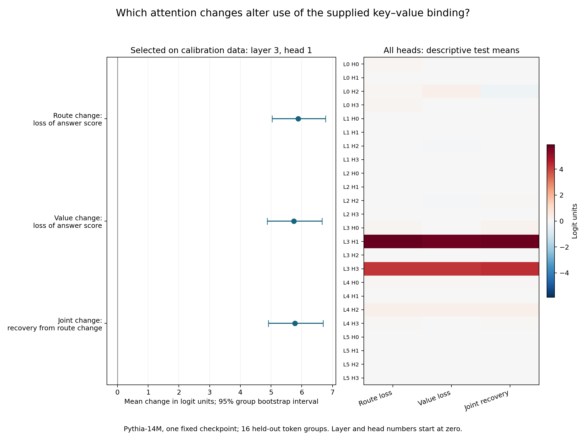

# How one attention head selects and copies a supplied value

**A fixed Pythia-14M experiment with competing key–value pairs**

13 October 2026. AI-authored research report with independent AI result review. No human peer review is recorded.

## Abstract

A language model can complete a repeated pattern by finding a matching key and copying the value that followed it. This mechanism is well established. We test one part of it in a small pretrained model, Pythia-14M. Our prompts contain two key–value pairs and end with one of the keys. We swap the bindings and pair order to separate use of the supplied pairs from word associations and recency. We select one attention head from calibration inputs, then test it on separate word groups. Changing where this head reads reduces the correct-answer score by 5.882 logit units. Exchanging the two contextual value vectors reduces it by 5.743 units. Applying both changes recovers 5.780 units relative to the route change. All three effects meet the fixed positive-interval rule. The combined change leaves the mean score close to its original value. This supports a local copying role for this head on these inputs. It does not identify the full copying circuit or establish a new induction mechanism.

## 1. The question

Consider a sequence with two pairs:

`A B ... C D ... A`

One possible next item is B, because B followed the earlier A. Another is D, because D is more recent. A model could also prefer B because it has a learned association with A. A useful mechanism test must separate these explanations.

We therefore also use `A D ... C B ... A`, reverse the order of the two pairs, and end the sequence with C. A fixed association between the words cannot by itself explain a preference that follows all these binding changes. The inputs use single word tokens, but the sequence is a controlled token task rather than ordinary prose.

Inside an attention head, the attention weights determine where the head reads. The value vectors determine what it reads. We test whether these two paths make a causal contribution to use of the supplied binding. Our central prediction is simple: a wrong route should harm the answer; an exchange of the two values should also harm it; the two changes together should restore some of the answer signal.

This joint effect is a prediction to test. It is not guaranteed by the code. The route change can alter attention to all past positions, while the value change affects only two positions.

## 2. What this study adds

Elhage et al. separated attention into query–key routing and output–value paths in their [transformer-circuits framework](https://transformer-circuits.pub/2021/framework/index.html). Olsson et al. then studied [induction heads](https://arxiv.org/abs/2209.11895v1), which complete repeated token patterns. These works provide the mechanism tested here.

Our study also has close empirical precedents. [Crosbie and Shutova](https://arxiv.org/abs/2407.07011v3) use head ablation and attention knockout to test pattern matching. [Bajaj et al.](https://aclanthology.org/2026.eacl-long.355/) test repeated anchors, temporal order, competing episodes, and heads selected by induction score. The broad questions about copying, routing, and recency are therefore not new.

The added result is a small, fully specified experiment on one fixed Pythia-14M checkpoint. It combines balanced binding controls, separate calibration and test word groups, route and value changes, and a full table for all 24 heads. We report evidence for this local computation. We do not claim a new general method. [Che and Li](https://arxiv.org/abs/2610.07270v1) give a related warning: control by an intervention is not enough to identify the complete natural mechanism. The [source record](sources.md) gives source versions and the exact overlap.

## 3. Method

### Model and fixed plan

We use `EleutherAI/pythia-14m` at revision `cf967c0a9a04383db6f7b1108d86b2962634b4ac`. It has six layers and four attention heads in each layer. The model is fixed; we do not train it. Calculations use float32 on a CPU. The model card records a change to this model address in February 2026, so the revision and file hashes are important for reproduction.

The [plan and runner were published before the scientific run](https://github.com/gavenren/mechanistic-interpretability-research/tree/512fdba309df32aa3a98db59c65ec5d5d383635f/studies/2026-10-13-copy-routing). The run checked their bytes against that commit before and after the experiment. This public plan lock is not a formal external registration.

### Inputs and head choice

The fixed tokenizer supplies 128 word tokens for 32 groups of four. Each token has a leading space and three to eight lower-case letters. The generator takes eligible tokens in token-ID order before it shuffles them with a fixed seed. A further 64 tokens supply the filler. This rule limits selection based on results, but it does not make the word pool a representative sample of language.

Each group has both binding assignments, both pair orders, both final keys, and gap lengths of 0, 4, and 12 tokens. There are 24 prompts per group, or 768 in total. Half the groups are for calibration and half are for testing. Test keys and values do not occur as calibration keys or values. Filler tokens are shared.

For each head, we measure attention to the value bound to the final key, minus attention to the competing value. We select the head with the highest mean calibration score. This rule selects **layer 3, head 1**, where numbering starts at zero. Its calibration score is 0.528. We use no intervention outcome to select it. All test heads remain in the published results, but only this selected head has primary status.

### Changes to the selected head

The route donor has the same prefix as the receiver and the other final key. At the final query, we copy the donor's attention distribution over past positions. We scale it to keep the receiver's total attention to the past fixed. We also keep the receiver's self-attention weight fixed. Receiver value vectors stay in place.

The value change exchanges the two value vectors at the positions of B and D. It affects only the selected head's final-query calculation. It does not change the outputs for earlier queries. These vectors contain context and position information as well as token information; the exchange does not isolate a pure word meaning.

The joint change applies both operations. Downstream layers then run normally. No other head is directly changed.

### Scores and uncertainty

The answer score is the logit of the value bound to the final key minus the logit of the other value. A logit is a model score before conversion to a probability. A positive answer score means that the model prefers the bound value in this two-value comparison. The balanced mean measures sensitivity to the supplied binding.

The three primary effects are the loss of answer score from the route change, the loss from the value change, and recovery from the route change when the value change is added. The plan requires positive lower bounds for all three effects. It also requires positive lower bounds for the baseline binding score and the selected head's test attention score.

Intervals use 10,000 bootstrap samples of the 16 complete test token groups. All variants of a group stay together. These intervals describe variation across this small pool. They do not estimate uncertainty across all language or model checkpoints.

## 4. Results

### The model uses the supplied binding in the two-value comparison

On the 384 test prompts, the model prefers the bound value to the competing value in **368 cases, or 95.8%**. The mean answer score is **5.317 logit units**, with a 95% interval of **[4.787, 5.861]**. The mean recency score is 0.367 units, which shows a smaller preference for the later value when both final keys are averaged.

This task is easier than unrestricted generation. The bound value is the highest-scoring token in the full vocabulary on only **112 of 384 prompts, or 29.2%**. The two-value success rate must not be presented as a 95.8% rate of producing the correct next token.

| Gap length | Test prompts | Mean binding score | Correct in the two-value comparison | Correct top token in the full vocabulary |
| --- | ---: | ---: | ---: | ---: |
| 0 | 128 | 5.631 | 124 | 35 |
| 4 | 128 | 5.173 | 121 | 35 |
| 12 | 128 | 5.147 | 123 | 42 |

The selected head also follows the binding on test inputs. Its attention weight on the bound value exceeds its weight on the other value by a mean of **0.596**, with interval **[0.532, 0.660]**.

### The route and value changes have the predicted effects

| Comparison for layer 3, head 1 | Mean effect in logit units | 95% group bootstrap interval |
| --- | ---: | ---: |
| Loss from the route change | 5.882 | [5.034, 6.770] |
| Loss from the value change | 5.743 | [4.876, 6.658] |
| Recovery from the route change after both changes | 5.780 | [4.909, 6.698] |
| Recovery from the value change after both changes, secondary | 5.641 | [4.740, 6.589] |
| Joint change minus baseline, secondary | −0.101 | [−0.207, 0.001] |

The mean answer score changes from 5.317 to **−0.564** under the route change and to **−0.425** under the value change. With both changes, it returns to **5.216**. Thus each separate change reverses the mean two-value preference. The combined change returns the mean close to its original value.

All five parts of the fixed positive-interval rule pass. The three primary effect means have the same positive signs at each gap and for both pair orders. These subset checks are descriptive; the primary test pools the fixed test set.

The combined result does not prove exact restoration on each prompt. An interval for the mean joint change that includes zero is also not an equivalence test. The supported statement is that the two changes largely compensate in the mean on this dataset.

*The left panel shows the preselected head and its group bootstrap intervals. The right panel gives descriptive means for every head. Positive route and value losses mean worse use of the supplied binding. Positive joint recovery means improvement over the route change alone.*

The full table shows that the selected head is not the only head with large effects. For example, layer 3, head 3 has route and value losses of 4.185 and 4.188 units. It was not selected for primary inference. The study does not test the combined roles of these heads or the full upstream circuit.

### Required controls pass

The unchanged custom attention path gives the same logits as stock eager attention. A same-query route donor and a double value exchange also give exactly the same logits in the required controls. A full donor attention row and donor value matrix reconstruct the donor's local head vector exactly. Past value vectors match between paired query runs.

All untouched head outputs and attention rows remain exact. Self-attention mass is unchanged. The largest attention-row sum error is **3.58 × 10⁻⁷**, below the fixed tolerance of 2 × 10⁻⁶. No donor has zero past-attention mass. The run includes 27,648 intervention examples and completes without a required-control failure.

## 5. Interpretation and limits

The results support a specific causal account. In this model, the selected head reads from a value position that depends on the supplied key. Its contextual value vectors then help determine which value the model prefers. The two artificial changes disrupt these two parts, and their combination largely restores the mean answer signal. Both binding assignments and both pair orders are needed for this interpretation.

Several limits remain. We test one small checkpoint, one fixed token pool, and sequences of at most 30 tokens. We do not test prose understanding, long-context retrieval, or other models. Shared fillers also limit the test of vocabulary transfer.

The route edit changes a distribution over many past positions. The value edit swaps contextual vectors. Neither operation is a pure intervention on one human-defined concept, and neither is guaranteed to produce a state that occurs on a natural input. The result therefore applies to these exact operations.

We test one head at a time and leave downstream computation active. Upstream heads and MLPs may create the information that the selected head uses. Other heads also have large effects. The study does not establish that this head is sufficient by itself, necessary under all interventions, or the sole place where copying occurs.

The useful result is a transparent positive case with a limited claim: in this fixed task, route and value information in one preselected head jointly support use of the supplied binding. The complete inputs, code, controls, and all head outcomes are available for further tests.

## 6. Reproduction and research status

The [README](README.md) gives the commands. The [analysis plan](analysis-plan.md), [source record](sources.md), [pre-run review](reviews/pre-run-review.md), and [result manifest](results/manifest.json) are included. The run uses public model files whose hashes are checked before use. The plan and runner stay unchanged from the published lock commit.

A separate AI agent checked all 9,216 intervention rows, all group summaries, the selected head, and the bootstrap intervals. It also ran an independent implementation of all baseline attention rows and target logits, plus all 1,152 intervention examples for the selected head. All comparisons matched exactly. The other 23 heads received full table arithmetic checks, but their interventions were not independently rerun. The [audit receipt](reviews/independent-audit.json) records this scope.

This paper is AI-authored. AI review is not human peer review. The repository records no human peer review for this study.
