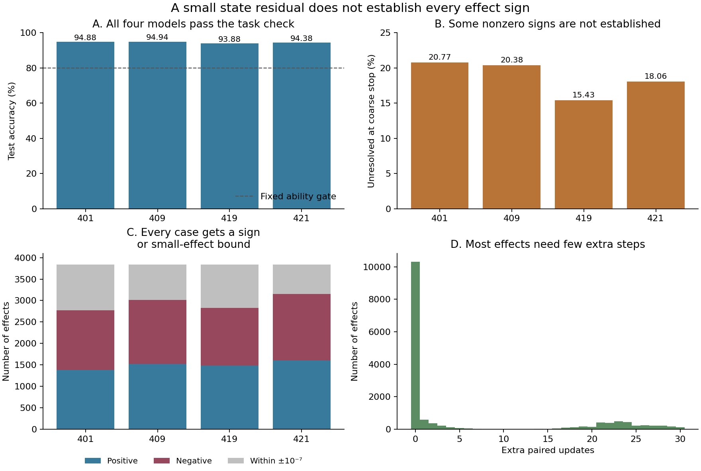

# When a small solver residual does not establish a neuron's effect

**13 October 2026. AI-authored numerical verification study.** The plan and code were public before the experiment, at [commit 1403654](https://github.com/gavenren/mechanistic-interpretability-research/commit/1403654ed629ff41dee40c8d094586c5eb40af73). Independent AI replay is complete. Human peer review has not occurred.

## Abstract

An equilibrium network updates its internal state until the state changes very little. A small remaining change does not, by itself, establish whether removal of a neuron raises or lowers an output. We tested this point in four small digit classifiers. At a fixed state-residual limit of 0.001, a conservative numerical bound did not establish the sign of 18.66% of the nonzero estimated effects, averaged equally over models. This is an unresolved-bound rate, not a wrong-sign rate. Further updates established a sign for 11,775 effects and a magnitude no greater than 10⁻⁷ for 3,585 effects. Five initial signs were proved to be reversed. No case reached the update cap. All models passed the fixed task-ability check. The contribution is a complete, reproducible sign audit using established contraction bounds and checked interval arithmetic. It is not a new causal principle or a claim about equilibrium models in general.

## Why check the effect as well as the solver?

Mechanistic studies often remove an internal component and measure the output change. In an equilibrium model, this requires two numerical solutions: one with the original equations and one with the edited equation. Each unfinished solution can change the estimated effect. The difference can be small even when both state errors matter.

Prior work already establishes equilibrium networks, output certification, and misleading effects of solver choices. CerDEQ bounds outputs under input perturbations; Yang and colleagues study forward/backward solver mismatch. Singh shows why a learned initializer or direct input path can confound claims about equilibrium computation. Mooij explains why an intervention must identify the equation being changed. Our [source record](sources.md) gives the checked methods and limits of overlap. We apply standard bounds to one fixed internal-removal question. We do not claim priority for certification, solver warnings, or equation replacement.

## Fixed experiment

We trained four models with seeds 401, 409, 419, and 421 on the original UCI optdigits training split. Each model has 64 inputs, 32 recurrent state coordinates, 10 output scores, and 3,434 parameters. Training used 40 epochs and a fixed 32-step unrolling from zero. The evaluated target was then the equilibrium of the saved weights. Finite-unroll training and equilibrium evaluation are different computations.

The state equation was

`z = ReLU(Wz + Bx + b)`, with output `Vz + d`.

There was no learned initializer or direct input-to-output branch. Each row of W was projected toward an absolute row sum of 0.875. A separately computed outward upper bound verified that the contraction factor was below one. Thus, each original or edited system had a unique equilibrium.

The intervention replaced exactly one coordinate equation with `z_j = 0`. All other equations and the readout stayed fixed. We solved the edited system again. This definition was unchanged throughout the study.

We used all 1,797 test images for ability checks. The effect panel contained the first 12 test-file rows per digit, sorted by row number: 120 images, all within rows 0–127. This is a small file-order panel, not a random sample. Every image–coordinate pair was retained, giving 3,840 effects per model and 15,360 in total.

The full-test and class-pair solves used a residual limit of 10⁻¹²; the removal-effect solves used 0.001. For each image, the two classes with the highest original output scores fixed the margin. A positive effect means that removal reduced the original top-class margin over its runner-up. A negative effect means that removal increased it. These classes stayed fixed after removal. They need not be the correct digit labels.

## What the bounds mean

The numerical target treats each stored binary64 weight and input as its exact real value. It does not treat the result of a finite floating-point solve as the target.

If a map contracts distances by at most q, a candidate state with residual at most r has state error at most `r/(1−q)`. For a fixed margin coefficient vector c, the effect error is at most

`||c||₁ × (r_original + r_removed)/(1−q)`.

The computation also encloses the estimated margin difference. Every bound operation rounds outward, including the input products, residuals, coefficient difference, norms, denominator, and final endpoints. These are standard inequalities, not new theorems. The guarantee assumes correct IEEE-754 binary64 elementary operations and `nextafter`, with the stated underflow behavior. It is not a formal verification of NumPy or the processor.

Both ordinary solves first stopped at a residual no greater than 0.001. The primary result was the fraction of nonzero ordinary effect estimates whose bound still included zero. We then updated both states until the interval excluded zero, lay within ±10⁻⁷, or reached 128 extra paired updates. Sign had priority over small magnitude. An interval within ±10⁻⁷ does not prove an exact zero effect. All thresholds and stop rules were fixed before model calls.

## Results

All models exceeded the fixed 80% accuracy gate. The tight full-test bounds established the computed top class on all 7,188 model–image cases.

| Seed | Test accuracy | Nonzero coarse effects | Signs unresolved by the initial bound | Fraction | Certified reversals |
|---|---:|---:|---:|---:|---:|
| 401 | 94.88% | 3,019 | 627 | 20.77% | 1 |
| 409 | 94.94% | 3,258 | 664 | 20.38% | 0 |
| 419 | 93.88% | 3,033 | 468 | 15.43% | 1 |
| 421 | 94.38% | 3,367 | 608 | 18.06% | 3 |

The equal-weight mean was **18.66%**. There were also 2,683 ordinary zero estimates. Including those cases, 5,050 of 15,360 initial intervals contained zero. A wide sufficient bound can fail to establish a sign even when the initial sign is correct. These counts therefore do not measure a rate of wrong explanations.

After further updates, 5,982 effects had a positive bound, 5,793 had a negative bound, and 3,585 had a small-magnitude bound. None remained unresolved at the cap. Of the small-magnitude cases, 902 had started with a nonzero ordinary estimate. All cases remain in the saved tables.

The five reversals were small in absolute model-margin units. Their initial magnitudes ranged from 0.000128 to 0.002159. For example, in seed 421, test row 102, coordinate 12, the initial effect was +0.002159. After 13 extra paired updates, its interval was entirely negative: approximately [−0.00024751, −0.00003681]. This proves a wrong initial sign for the specified exact-real target. It does not isolate floating-point rounding as the cause: finite stopping error is part of the comparison. [All five cases](report/reversals.csv) are reported.

**Figure 1.** Panels A–C use one bar per fixed model. Panel B uses nonzero coarse effects as its denominator. Panel C separates established signs from small magnitude; the grey category is not an exact-zero claim. Panel D includes all effects, including the 10,310 that needed no extra update. The figure contains no statistical confidence interval.

## Added computation and checks

Refinement used 87,218 extra paired updates: a mean of 5.68 per effect, with a maximum of 30. One paired update advances both the original and removed state. Across evaluation and controls, the run used 5,454 ordinary map calls over 706,131 state rows. It made 177 certificate requests, which required 294 validated residual-map passes over 212,344 rows. Input affine enclosures were counted separately. A bound request can cost more than an ordinary map; these counts are not equal units of runtime. See [the full cost definitions](results/cost-definitions.json) and [per-model costs](report/costs.csv).

Training used 4,800 optimizer updates and 19,573,760 forward state-update examples; backward work was additional. The complete run took 19.80 seconds on the recorded CPU setup, within the 1,200-second cap. This timing is local evidence, not a hardware-independent speed claim.

All 9,975 scientific controls passed. Before the run, the author checked 1,697 exact rational conditions, a separate AI reviewer checked 1,512 more, and the full dummy procedure passed 383 checks. These included nonzero effects, a known sign reversal, all stop outcomes, and a full-cap unresolved case.

The [independent result audit](reviews/independent-result-audit.json) used separate solver and interval code. It matched all 53,748 saved state rows, 102,578 refinement-history rows, 15,360 effect rows, bounds, stop decisions, and work counters exactly. It checked the training records and schedules but **did not repeat training**. The audit took 9.03 seconds. [The result manifest](results/manifest.json) fixes the recorded files.

## Limits and use

The uncertainty rate depends on this global contraction bound, the residual threshold, the readout scale, and this fixed data panel. A tighter local bound could establish more signs at the same candidate states. Four seeds and one small architecture do not establish a population failure rate. We did not test other tolerances or intervention meanings after seeing the results.

The first-update classifiers already reached 89.09–93.49% accuracy. Their predicted classes differed from the equilibrium predictions on 4.17–9.63% of test cases. The zero-state readout was near 10% accuracy. These checks show that the trained input path is useful and that later updates sometimes change the decision. They do not identify a new reasoning mechanism.

For a contractive model with a fixed intervention, the useful reporting practice is to give the effect interval as well as the solver residual. Keep unresolved cases separate from proved sign reversals. Keep small-magnitude bounds separate from exact zeros. The present files show one low-cost way to make those distinctions auditable.
