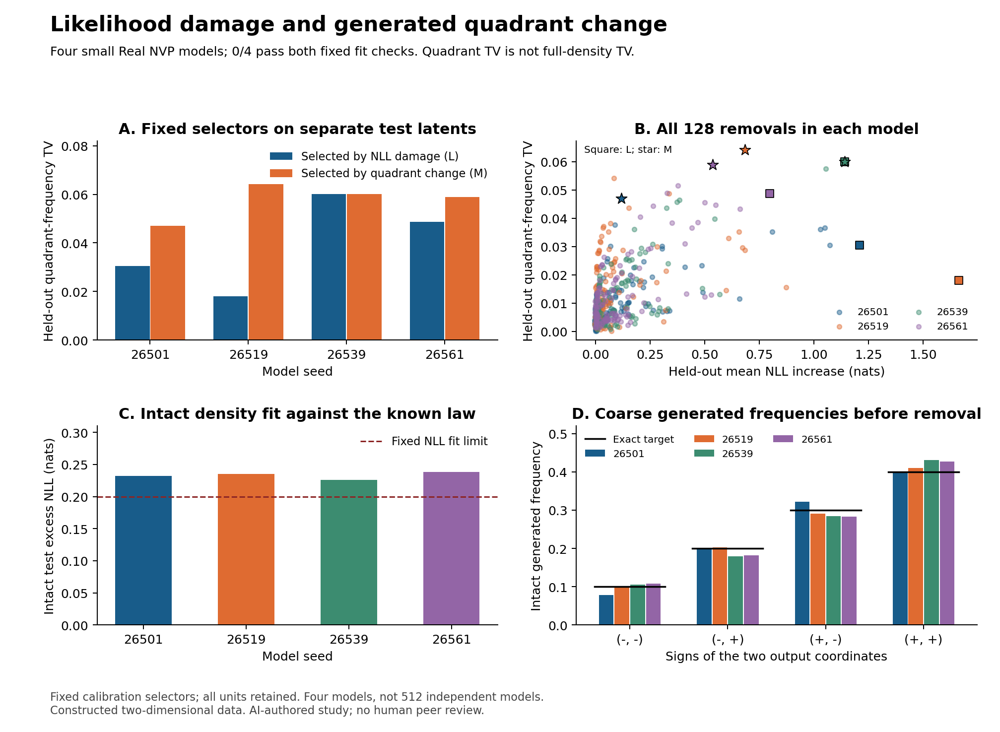

# Choosing flow neurons by likelihood damage or output change

**Date:** 13 October 2026  
**Status:** Fixed experiment complete; independent AI result audit and [claim review](reviews/independent-review.md) complete.  
**Public plan and code lock:** [`4a52bcb4c102851338f7eb99179192ae0153da2d`](https://github.com/gavenren/mechanistic-interpretability-research/commit/4a52bcb4c102851338f7eb99179192ae0153da2d)  
**Scope:** Four small models on constructed two-dimensional data. All four failed the fixed density-fit rule. No human peer review.

## Abstract

We tested two ways to choose an internal neuron for removal from a generative model. One method chose the removal that most damaged likelihood on calibration data. The other chose the removal that most changed the frequencies of generated points in four quadrants. All four models failed the fixed density-fit limit, although all passed the quadrant-frequency limit. The results therefore concern imperfectly fitted models. On separate test samples, the output-based choice produced a larger quadrant change in three models. The two choices were identical in the fourth. Mean quadrant-frequency total variation was 0.05753 for the output-based choice and 0.03933 for the likelihood-based choice. This is a difference in the selected effect, not an improvement in sample quality. The experiment tested every one of 128 eligible neurons per model. A separate implementation reproduced all saved density terms and all generated count measures. The contribution is a small, fixed selection benchmark. Generator interventions and differences between likelihood and sample measures are established topics.

## 1. Question and close prior work

A flow model maps data to simple noise and can run the map in reverse to generate data. This makes it possible to measure a point's density and to generate samples from the same edited model. Real NVP established the affine coupling method used here. We introduce no new flow architecture. [Dinh, Sohl-Dickstein, and Bengio](https://arxiv.org/abs/1605.08803)

Likelihood measures how much density a model assigns to observed data. It does not directly say how often a generator enters a chosen region. Earlier work explains why likelihood and sample criteria can disagree. Earlier generator studies also remove internal units to measure their effects. Neither distinction is new here. [Theis, van den Oord, and Bethge](https://arxiv.org/abs/1511.01844); [Bau and colleagues](https://arxiv.org/abs/2009.05041)

*Taming Normalizing Flows* is particularly close. It uses a two-dimensional Gaussian-mixture example, changes a flow, compares density and generated attributes, and fixes latent inputs across some comparisons. Its method fine-tunes model weights. Its ablation study removes loss terms. We hold model weights fixed, remove each specified hidden neuron, and compare two calibration selectors on separate test samples. This narrow difference defines the scope of our study. Our source search does not establish priority. [Malnick, Avidan, and Fried](https://arxiv.org/abs/2211.16488)

Nearby work also ranks sparse-autoencoder features for rare attributes in diffusion generators. Our experiment does not claim to discover the general value of feature selection for generator analysis. [RAIGen](https://arxiv.org/html/2602.06806v2)

## 2. Fixed test

The data came from four Gaussian groups with centres at the four combinations of −2 and +2. Their weights were 0.1, 0.2, 0.3, and 0.4. Each coordinate had a within-group standard deviation of 0.55. We used 16,384 training points, 4,096 calibration points, and 8,192 test points. We also fixed 16,384 calibration noise inputs and 32,768 separate test noise inputs. All four models used the same arrays. Seeds, inputs, and batch schedules were fixed before training.

Each model had four affine coupling blocks. Each block had 32 tanh hidden neurons. The model had 520 trainable parameters and 128 eligible neurons. Each model received exactly 4,000 Adam updates. All training and evaluation arithmetic used float64 after the fixed initialization procedure. We did not extend training after a failed fit check.

A removal set one post-tanh hidden scalar to zero whenever its block ran. It changed both the encoding and decoding directions. This matters: the edited density and the edited generator must describe the same model. An affine coupling remains invertible after this change. We retained every removal, including small and negative likelihood effects.

For each trained model, we measured every removal on calibration inputs. Selector **L** chose the largest mean increase in negative log likelihood, or NLL. Selector **M** chose the largest change in the four generated quadrant frequencies. We saved both choices before any test model call. Exact ties used the smaller neuron index. M uses extra generation measurements; it is a reference that directly measures the desired effect.

The quadrant score is half the sum of the absolute changes in the four frequencies. We call this **quadrant-frequency TV**. It is a coarse measure. It is not total variation between the full continuous densities. A point can move inside a quadrant without changing this score. Opposite boundary crossings can also cancel.

The sole primary result was test quadrant TV for M minus test quadrant TV for L. The four models are the replication units. Neurons and noise inputs are not additional model replications. The [fixed plan](analysis-plan.md) gives the exact arrays, training settings, checks, and counts.

## 3. All four models failed the density-fit rule

The fixed rule required excess test NLL of at most 0.20 nats and intact generated quadrant TV of at most 0.05. Excess NLL compares the model with the known data density on the same test points. All four models exceeded the NLL limit. All four passed the coarse frequency limit.

| Model seed | Excess test NLL | Intact quadrant TV against target | Passed both limits? |
|---|---:|---:|---|
| 26501 | 0.23241 | 0.02353 | No |
| 26519 | 0.23510 | 0.01194 | No |
| 26539 | 0.22566 | 0.03629 | No |
| 26561 | 0.23822 | 0.03510 | No |

The failure blocks the planned interpretation for well-fitted flows. It does not erase the intervention measurements. It limits them to these imperfect models. The fact that quadrant frequencies passed also does not imply good density fit inside each region. We report all generated means and covariances, including within each quadrant, in the [moment table](tables/intact-moments.csv). The same table gives test-data moments for context.

## 4. The output-based selector gave a larger coarse change in three models

| Model seed | L: test quadrant TV | M: test quadrant TV | Primary difference, M − L | Same selected neuron? |
|---|---:|---:|---:|---|
| 26501 | 0.03052 | 0.04703 | 0.01651 | No |
| 26519 | 0.01804 | 0.06415 | 0.04611 | No |
| 26539 | 0.06006 | 0.06006 | 0.00000 | Yes |
| 26561 | 0.04871 | 0.05887 | 0.01016 | No |
| Mean | 0.03933 | 0.05753 | 0.01820 | 1 of 4 |

The predeclared whole-model bootstrap gave a descriptive 95% interval of 0.00413 to 0.03712 for the mean difference. There are only four model seeds. This interval conditions on the fixed data and noise arrays. It does not include uncertainty from new noise samples, new data laws, or new architectures.

*Figure 1. A: the primary held-out comparison. B: all 128 removals per model; squares mark L and stars mark M. C: every intact model exceeds the fixed NLL fit limit. D: intact generated quadrant frequencies remain close to the target. The four colours identify models. These results do not measure sample-quality improvement.*

The likelihood selector did identify larger likelihood damage. Its selected removals increased test NLL by 1.20287 nats on average. The output-based selections increased it by 0.61964 nats. Thus the result does not show that L failed at its own objective. It shows that the two objectives selected different effects in three cases.

The full rankings were related. Test Kendall tau-b between NLL damage and quadrant TV ranged from 0.347 to 0.463. They were neither identical rankings nor unrelated measures. The [complete ranking table](tables/unit-rankings.csv) contains calibration and test results for every removal.

The paired-coordinate measures also show why quadrant TV is incomplete. For seed 26501, the M removal moved 9.88% of test points across a quadrant boundary. Its net quadrant TV was only 0.04703. Boundary changes in opposite directions partly cancelled. Across models, M had mean squared displacement 0.71989, compared with 0.45086 for L. Neither number states that the samples became better.

## 5. What the test can explain

A standard local identity gives one reason to separate the objectives. Suppose a smooth gate defines normalized densities q_a, and the intact density q_1 exactly equals the data law p. Under the usual condition that differentiation can pass through the integral,

`d E_p[-log q_a] / da at a=1 = - integral (d q_a / da) at a=1 = 0.`

The derivative of a single region's probability need not be zero. This follows from density normalization. It is established calculus, not a new theorem. It motivates the question but does not explain our finite removals by itself. Our edits went from a full unit to zero, and none of our models met the fixed density-fit rule. The experiment did not test a local derivative prediction.

The observed selector difference could depend on the model's fit errors, the chosen quadrant boundaries, the training procedure, and the finite calibration arrays. We did not separate those causes. We also did not establish that a neuron represents one Gaussian group or one human concept. A unit may change several parts of the density at once.

## 6. Controls, cost, and independent checks

The fixed run completed all 16,000 training updates and all planned conditions. It used 78,676 flow mapping calls and 67,780,864 input examples, including training and numerical checks. It took 91.71 seconds on two CPU threads. No paid service was used.

All 31,716 planned control rows passed. The largest coordinate round-trip error was 1.55×10⁻¹⁴. The largest log-determinant check error was 1.44×10⁻¹⁴, below the fixed 10⁻⁹ limit. No-op and local removal checks were exact. No model, unit, or result was dropped.

A separate AI reviewer used another implementation. The audit reproduced all 12,681,216 saved density terms exactly. It regenerated 50,724,864 output coordinates to check every quadrant count, transition count, displacement, and crossing measure. Saved coordinates for the selected conditions also matched exactly. All 1,032 score rows, selectors, rankings, fit checks, and the bootstrap matched. A separate analytic Jacobian check had maximum error 3.11×10⁻¹⁵. The audit took 67.29 seconds. It checked training records and schedules but did not repeat training. The [audit receipt](reviews/independent-audit.json) records this scope.

M requires calibration generation measurements. This study measured all removals for both selectors and then measured them all again on test inputs. It is a benchmark, not a demonstrated compute-saving procedure. It makes no claim that M is cheaper or suitable for high-dimensional generators.

## 7. Conclusion

In these four imperfectly fitted flows, choosing a neuron by observed calibration output change gave a larger held-out quadrant change in three models and the same change in one. The likelihood choice gave larger likelihood damage. This supports a narrow practical rule: state the output effect of interest and test whether a proposed neuron ranking selects that effect on separate inputs. The experiment does not show better samples, well-fitted density models, or neurons with isolated semantic meanings.

## Data and research record

The pre-run AI review was completed before execution. Its file is included with the result release. It was not part of the earlier public plan and code lock.

The [results manifest](results/manifest.json) hashes all scientific outputs. It includes the public lock and exact software versions. Raw density terms are saved for every condition and data point. Generated coordinates are saved for intact and selected test conditions. All other generated outputs can be replayed from the complete checkpoints and fixed noise arrays; they were not all archived as coordinates. Their count and effect summaries were archived.

The [selector table](tables/selector-comparison.csv) includes selected neuron IDs, NLL decomposition, displacement, crossings, and both fit measures. The [full unit table](tables/unit-rankings.csv) includes negative NLL effects. Over all units, test mean NLL damage ranged across models from 0.09611 to 0.11688 nats; individual effects ranged from −0.00552 to 1.66413 nats. Mean quadrant TV ranged from 0.01065 to 0.01404; individual effects ranged from 0.00015 to 0.06415. The [per-model summary table](tables/all-unit-summary.csv) gives all calibration and test means and ranges.

See the [reproduction guide](README.md), [source record](sources.md), and [pre-run AI review](reviews/pre-run-review.md). The study is AI-authored and AI-reviewed. No human peer review is claimed.
