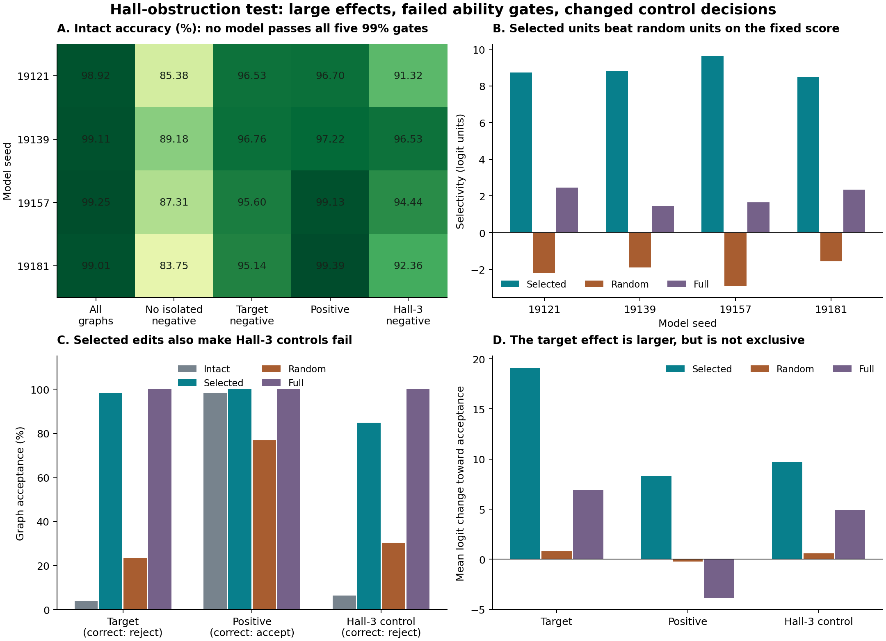

# Testing a Hall-rule interpretation in a small matching classifier

**Date:** 13 October 2026  
**Status:** Completed finite experiment. AI-written research with a separate AI review. No human peer review is claimed.  
**Plan and code fixed before training:** [`782dc2c8d73a3fa9e67a03c8cbd394a5548d9bf9`](https://github.com/gavenren/mechanistic-interpretability-research/commit/782dc2c8d73a3fa9e67a03c8cbd394a5548d9bf9).

## Abstract

We tested a proposed interpretation of a small neural network that decides whether a graph has a complete matching. The target case is simple: two left vertices each have only one possible partner, and that partner is the same right vertex. This makes a complete matching impossible. We selected four internal units from six-edge graphs, then removed those units on seven-edge graphs. Positive and negative control graphs had exactly the same labelled vertex degrees as the targets. Across four fixed models, the selected units had a mean selectivity score of 8.92 logit units, compared with −2.14 for eight fixed random unit sets. The primary selected-minus-random difference was 11.06, with a descriptive four-seed interval of [10.27, 12.10].

These large effects do not validate a Hall-rule component. All four models failed the fixed ability requirements. Accuracy on impossible graphs with no isolated vertex was only 83.75%–89.18%, despite overall accuracy near 99%. The selected edits also increased false acceptance of distinct-cause negative controls from 6.34% to 84.72%. Removing the whole first layer left a constant output, yet still gave a positive selectivity score of 1.98. The study therefore records a reproducible relative effect on a small, fixed set of graphs, with clear limits on its interpretation. It does not identify a unique matching algorithm or a complete circuit.

## 1. The question

A complete matching pairs each left vertex with a different right vertex. Consider four vertices on each side. If two left vertices can connect only to the same single right vertex, both cannot get a different partner. We call this a named Hall-2 obstruction. Its name specifies the two left vertices and their shared right vertex. There are 24 such names.

Hall's condition states that every set of left vertices needs at least as many possible right partners. A graph can fail this condition in more than one way. Our negative controls have no isolated vertex and no deficient left pair. They fail because a set of three left vertices has too few partners. We call these Hall-3 controls.

The empirical question is narrow: can a fixed unit-selection method find a small set whose removal moves the output toward acceptance more on a named Hall-2 target than on degree-matched controls? This is a test of relative effect specificity. It does not require unchanged control decisions. We report those decisions separately, because a useful score can conceal large control damage.

The exact task labels are known. The network's internal algorithm is not known. A correct label oracle does not provide ground truth about what an individual unit represents.

## 2. Relation to prior work

Neural matching is an established task. Georgiev and Liò's [Neural Bipartite Matching](https://arxiv.org/abs/2005.11304v4) learns parts of a Ford–Fulkerson procedure. Our model is a much smaller classifier. It does not execute that supervised procedure. [MINAR](https://arxiv.org/abs/2602.21442v1) studies internal components in graph reasoning models, and [Mechanistic Interpretability for Neural TSP Solvers](https://arxiv.org/abs/2510.21693v1) examines features in neural combinatorial optimization.

[Validating Mechanistic Interpretations](https://arxiv.org/abs/2407.13594v2) gives criteria for interpretation claims and includes a 2-SAT solver study. [Slaying the Hydra](https://arxiv.org/abs/2610.04017v1) studies component interactions and task-specific effects. These works rule out claims that graph interpretation, specificity tests, or joint component effects are new here.

Our contribution is the fixed finite test: exact labelled degree controls, a different negative cause, separate selection and intervention-test contexts, and complete results for every specified seed and unit. The [source record](sources.md) states the overlap and scope. A focused literature search does not establish priority.

## 3. Fixed method

### Graphs and the split

We enumerated all 65,536 binary 4×4 bipartite graphs. We calculated each label in two independent ways: enumerate all 24 complete matchings, and check all 15 nonempty left-subset conditions. Both gave 37,823 positive graphs. There were 3,680 negative graphs with no isolated vertex, including 1,248 that had no deficient left pair.

For each named obstruction, we kept every eligible graph within each retained degree class. A degree class fixes all eight labelled degrees, not just the number of edges. Each class contains target negatives, positive graphs, and Hall-3 negatives.

| Context, per obstruction name | Degree classes | Target graphs | Positive graphs | Hall-3 graphs |
|---|---:|---:|---:|---:|
| Selection: six edges | 3 | 6 | 78 | 12 |
| Intervention test: seven edges | 6 | 18 | 48 | 12 |

There are 1,224 unique selection graphs and 1,872 unique test graphs. The two sets do not overlap. All natural graphs, including both sets, are used for training. Thus, “test” means a held-out intervention context. It does not mean unseen-graph prediction.

Graph labels carry strong dependence. The entire natural set has only 317 row/column relabelling classes. For the first named obstruction, the selection categories contain 1, 3, and 1 such classes; the test categories contain 2, 2, and 1. Other names are relabelled versions of the same construction. We do not count these related graphs as independent model replications.

### Models and training

Each model is a fully connected network with widths 16, 64, 64, and 1, with ReLU after each hidden layer. It has 5,313 parameters. The 16 binary inputs encode the edges. A nonnegative output logit means acceptance. The sigmoid of that logit is the model's acceptance probability.

We used four fixed seeds: 19121, 19139, 19157, and 19181. Each model received 64 complete passes over all graphs, in the same fixed order. Training used Adam, a learning rate of 0.002, batches of 512, and binary cross-entropy. This gave 8,192 updates per model. All arithmetic used float64 on two CPU threads. There was no early stop, seed replacement, or result-based change to training.

### The edit and the score

An edit sets specified entries of the first post-ReLU hidden vector to zero. It does not change weights or other hidden entries. For a graph, let the effect be its edited logit minus its intact logit. A positive effect moves the output toward acceptance.

Within each degree class, let the mean effects on targets, positives, and Hall-3 controls be `eT`, `eP`, and `eC`. The fixed selectivity score is:

`selectivity = eT − max(0, eP, eC)`.

A positive value means that the target moves toward acceptance more than either control category. It does not mean that only the target changes. A uniform positive shift receives zero; a uniform negative shift receives a negative score.

For each model and named obstruction, we ranked all 64 single-unit edits by mean selection score. Exact ties used the lower unit index. We selected the top four units, even if all single-unit scores were negative. We then measured the four-unit edit directly. We did not assume that four single-unit effects add together.

Eight fixed random four-unit sets provide a size-matched reference. Their exact unit IDs are in [the input ledger](inputs.json). They are not matched for removed activation magnitude. Empty-mask and full-first-layer edits provide numerical and interpretive controls. All 98 masks were evaluated on all 3,096 intervention graphs. All single-unit results are retained, including units that were not selected.

### Primary endpoint and interpretation rules

The sole primary comparison is the test selectivity of the selected set minus the mean test selectivity of the eight random sets. We average degree classes within each name, then the 24 names within each model. We form the selected-minus-random difference inside each model before averaging the four models.

The reported interval uses 10,000 resamples of the four whole-model differences. It is descriptive. It is not evidence about a broad population of architectures or training methods.

The fixed interpretation rule is stricter than a positive primary score. Each model must have positive raw selected selectivity, a positive selected-minus-random difference, and at least 99% intact accuracy in each of five categories. A panel-wide interpretation requires all four models to meet all conditions. Every model remains in the results if a condition fails.

## 4. Results

### All four models failed the ability requirements

Overall accuracy was close to 99%. Accuracy on impossible graphs with no isolated vertex was much lower. These graphs are only 5.62% of the full natural set. Thus, the overall number gives a poor account of this part of the task.

| Seed | All graphs | No-isolated negatives | Test targets | Test positives | Test Hall-3 | All five ≥99%? |
|---|---:|---:|---:|---:|---:|---|
| 19121 | 98.92% | 85.38% | 96.53% | 96.70% | 91.32% | No |
| 19139 | 99.11% | 89.18% | 96.76% | 97.22% | 96.53% | No |
| 19157 | 99.25% | 87.31% | 95.60% | 99.13% | 94.44% | No |
| 19181 | 99.01% | 83.75% | 95.14% | 99.39% | 92.36% | No |

The five denominators are 65,536, 3,680, 432, 1,152, and 288 unique graphs. We did not remove incorrect cases before scoring edits. Final full-dataset cross-entropy losses ranged from 0.0192 to 0.0290. We did not extend training after these failures.

### The selected edits had large relative effects

| Seed | Raw selected score | Random mean score | Primary difference | Full-layer score |
|---|---:|---:|---:|---:|
| 19121 | 8.725 | −2.183 | 10.908 | 2.453 |
| 19139 | 8.814 | −1.903 | 10.717 | 1.462 |
| 19157 | 9.659 | −2.907 | 12.567 | 1.656 |
| 19181 | 8.481 | −1.571 | 10.052 | 2.336 |
| Mean | **8.920** | **−2.141** | **11.061** | **1.977** |

Values are logit units. The primary descriptive interval is **[10.266, 12.104]**. All 24 named raw scores were positive in every model. The full per-name results are in [named-scores.csv](tables/named-scores.csv). Despite these positive scores, all four per-model interpretation conditions, and the panel condition, failed because of the ability results.

### The selected edits also changed the controls

The target effect was larger than the control effects. But the controls were not preserved.

| Edit | Target logit change | Positive logit change | Hall-3 logit change |
|---|---:|---:|---:|
| Selected four units | +19.125 | +8.301 | +9.691 |
| Random four units, mean | +0.787 | −0.206 | +0.597 |
| Whole first layer | +6.918 | −3.866 | +4.936 |

For the selected edit, mean acceptance probability rose by 90.52 percentage points on targets, 5.09 points on positives, and 72.11 points on Hall-3 controls. The following decision rates make the negative-control damage explicit.

| Output condition | Target acceptance, wrong | Positive acceptance, correct | Hall-3 acceptance, wrong |
|---|---:|---:|---:|
| Intact | 3.99% | 98.11% | 6.34% |
| Selected four units removed | **98.32%** | **99.98%** | **84.72%** |
| Random four units removed, mean | 23.49% | 76.79% | 30.38% |
| Whole first layer removed | 100.00% | 100.00% | 100.00% |

These are equal-weight model/name/degree-class averages, with an additional equal weight over random masks. They are not counts of independent cases. They can differ from the unique-graph ability rates above. The positive control's acceptance is mostly preserved by selected edits; the distinct-cause negative control is not.

The edits also remove different amounts of activation. Mean removed-vector norms for selected edits are 1.260 on targets, 0.793 on positives, and 0.807 on Hall-3 controls. Random edits give 1.113, 1.106, and 1.113. Thus, the effect comparison is size-matched by unit count, but not by perturbation magnitude. The experiment does not separate magnitude from direction as explanations of the larger target effect.

### A constant output still receives positive selectivity

Removing the entire first layer leaves the second-layer bias and output weights. The output then has no graph information. Each model returns one positive logit: 1.4463, 0.7222, 1.4377, or 0.5676. Every study graph is accepted.

This control still receives a mean selectivity score of **1.977**. The reason is that an effect is measured relative to each category's intact logit. Different starting margins can give different changes even when the final output is constant. The selected score exceeds this control, but a positive raw score alone cannot prove a semantic component. The primary random-set comparison reduces one simple alternative; it does not remove this interpretation limit or repair failed ability.

*Figure 1. A: all four models fail at least one fixed ability requirement. B: selected sets beat random sets on the specified score; the constant-output control also scores above zero. C: selected edits cause many Hall-3 control errors. D: the target logit changes more, but all three categories change. Panels C and D use the planned equal weights. The figure reports no new primary endpoint.*

## 5. Checks, cost, and reproducibility

The run completed in 36.16 seconds on two CPU threads. It used 32,768 training updates and 16,777,216 training examples. The repository retains initial weights and eight scheduled weight snapshots per model, the exact epoch orders, all 262,144 intact outputs, and all 1,213,632 ablation outputs. It also retains 64,800 degree-group score rows, the full unit rankings, selected and random masks, and activation-change norms.

All 1,188 planned numerical controls passed the fixed 1e-10 tolerance. The maximum error was 1.11e-16. These checks cover cached continuation, untouched entries, zeros at selected entries, restoration of the saved original vector, empty-edit identity, and the bias-only full-layer output. Passing numerical controls establishes that the intended edit was implemented within this scope. It does not establish the proposed interpretation.

The run checks the exact bytes of the public plan, runner, inputs, source record, and requirements before and after execution. The [manifest](results/manifest.json) hashes every saved result file. The separate pre-run AI review independently rebuilt all graph groups and their labels.

A separate [result audit](reviews/independent-audit.json) used full forward passes from saved weights. It reproduced all 262,144 intact logits and all 1,213,632 edited logits exactly. It also rebuilt the rankings, selected masks, 64,800 score rows, ability gates, and primary interval. The largest reported arithmetic difference was 1.78e-15, below the fixed 1e-10 bound. The replay used 3,256 full forward calls and took 10.98 seconds. It **did not repeat training**. The separate [result and claim review](reviews/independent-review.md) is complete.

## 6. Limits and conclusion

This study does not validate a Hall-2 component. It shows that the fixed selection rule finds sets with positive relative effects on a narrow intervention test, while all models fail the prior ability requirements and the edits damage distinct-cause controls.

The limits are concrete. Training includes every natural graph, so there is no test of unseen-graph prediction. The finite contrast covers few graph structures, with many relabelled copies. Four seeds do not support a broad model-family claim. Zeroing hidden units can create states that natural inputs do not produce. A set selected for a larger target effect need not be a unique, necessary, or sufficient Hall computation. Different activation magnitudes and intact margins can contribute to the score.

The useful result is therefore the complete test record. Near-99% overall accuracy and a large selected-minus-random effect were not enough to meet the study's fixed interpretation rule. A later study could train a model that meets the ability gates and test more graph structures and intervention types. That would require a new plan. We did not make those changes after seeing these results.

## Research record

- [Fixed analysis plan](analysis-plan.md), [input ledger](inputs.json), and [source record](sources.md).
- [Runner](code/run.py), [report generator](code/report.py), and [reproduction steps](README.md).
- [Complete result summary](results/summary.json), [run metadata](results/run-metadata.json), and [file hashes](results/manifest.json).
- [Model scores](tables/model-scores.csv), [ability results](tables/ability.csv), [all named scores](tables/named-scores.csv), and [category effects](tables/category-effects.csv).

The writing, code, and separate review were produced with AI assistance. This is a public research artifact, not a claim of human peer review or established discovery.
