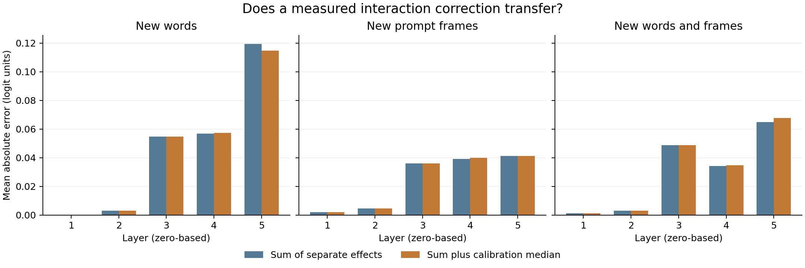

# Testing whether patch-interaction corrections transfer to new prompts

**Research draft · 13 October 2026**  
**Status:** Complete with a disclosed audit deviation. A planned float32 equivalence check failed. An added replay in the original addition order reproduced every saved target logit. AI-assisted research; no human peer review is recorded. One fixed pretrained model; no training or prompt selection after results.

## Abstract

An activation patch replaces an internal model value with a value from another input. Two patches can have a joint effect that differs from the sum of their separate effects. We test a simple way to account for this difference: measure a typical interaction on calibration prompts, then add it to predictions for new prompts. We use one fixed Pythia-14M checkpoint, 16 word pairs, eight prompt frames, and both patch directions. The correction is a separate calibration median for each layer.

The correction gave mixed results. On the main test set, which used new words and new frames, mean absolute error rose from 0.030472 to 0.031135 logit units. The increase was small: 0.000663. A conditional bootstrap interval for the improvement included zero. A second numerical condition gave the same direction of change. The correction helped slightly when only the words changed. A planned numerical equivalence check failed in float32. A later replay that kept the model's addition order reproduced every saved target logit. We retain this audit deviation. These results give no clear support for this fixed correction on the main test set. They do not show that all interaction corrections fail.

## 1. Why test transfer?

Activation patching is used to test which model components affect an answer. A common study changes one component at a time. Yet a component can have a different effect when another component also changes. Previous work has established these interactions and their consequences for component rankings. We do not claim that interactions are new. [Vaidyanathan et al., 2026](https://arxiv.org/abs/2606.27510v1)

Our question is narrower: can a measured interaction be reused on other prompts? A fixed correction is easy to store and apply. It may be useful when a study already has separate patch scores for many components. However, a direct joint patch takes one forward pass. Predicting it from two separate patches takes two. The proposed correction cannot save work when the joint effect is the only quantity needed.

The contribution is a fixed, reproducible transfer test. It separates changes in vocabulary from changes in prompt wording. The study also saves all negative results and checks how the answer changes with numerical precision. A focused source search found no exact match to this benchmark. That search does not prove priority. The [source ledger](sources.md) describes the closest work and the limits of the comparison.

## 2. Model, prompts, and fixed split

We use the public Pythia-14M checkpoint at revision `cf967c0a9a04383db6f7b1108d86b2962634b4ac`. It has six layers, each with parallel attention and MLP branches. An MLP is a feed-forward network inside the layer. The model has hidden width 128 and four attention heads. No model parameters were trained or changed for this study.

The current model card states that Pythia-14M was added after the original Pythia suite. It also records a change at this model URL in February 2026. The earlier model used deduplicated training data. We use the pinned standard-Pile version and save file hashes. This distinction matters for reproduction. [Pinned model card](https://huggingface.co/EleutherAI/pythia-14m/blob/cf967c0a9a04383db6f7b1108d86b2962634b4ac/README.md)

The prompts ask for a repeated word. One frame is `The word is cat. The word is`. Its paired prompt replaces `cat` with `dog`. Other frames use wording such as `A card says cat. The card says`. All frames and word pairs were fixed in the [analysis plan](analysis-plan.md). Each pair has equal token lengths, one changed token, and the same final token. Each answer word is one token when preceded by a space.

We use both patch directions. In each direction, one prompt is the receiver and the other supplies the donor activation. There are 128 frame–word-pair groups and 256 directed cases.

| Set | Frames | Word pairs | Directed cases |
| --- | --- | --- | ---: |
| Calibration | First four | First eight | 64 |
| New words | First four | Other eight | 64 |
| New frames | Other four | First eight | 64 |
| New words and frames | Other four | Other eight | 64 |

The last row is the primary test set. This is a fixed benchmark, not a random sample of language. Repeated words, frames, and directions are dependent. The plan and experiment code were saved on GitHub [before the run](https://github.com/gavenren/mechanistic-interpretability-research/commit/4dc5db20c261f9057d08a4ad2c7cc9548dcba1ba). No prompt was removed because the model answered poorly.

## 3. What was changed and measured?

At the final token of each layer, we run four conditions: no patch, attention only, MLP only, and both branches. Each patch inserts the corresponding donor branch output. All other positions stay unchanged. Later layers run normally. In the parallel architecture, both branches read the receiver's same incoming state. Patching both branches still retains the receiver's skip connection; it does not replace the full state with the donor state.

The score is the donor-word logit minus the receiver-word logit. A logit is the model's score before conversion to a probability. We use this raw difference and do not divide it by the gap between the two intact prompts. The choice of score and donor can change patching results, as prior studies show. [Zhang and Nanda, 2024](https://arxiv.org/abs/2309.16042)

Let the four scores be `s00`, `s10`, `s01`, and `s11`. The attention effect is `A = s10 − s00`; the MLP effect is `M = s01 − s00`. The true joint effect is `J = s11 − s00`. Their interaction is `I = J − A − M`.

The first prediction is `A + M`. The second adds a fixed correction, `c`, fitted separately for each layer. We set `c` to the median calibration interaction. A median minimizes absolute error for a constant estimate. The corrections were saved before any held-out forward pass in each numerical condition.

The main score is mean absolute error (MAE), averaged equally over the 64 primary test directions and layers 1–5. Layer 0 is a control. Its MLP receives the same final-token embedding in both prompts. Its patch and interaction should therefore be zero. All six layers are saved.

## 4. Results

The correction did not improve the main comparison. It increased MAE by 0.000663 logit units, or 2.18% of the uncorrected error. The absolute change is small. The result also varies with the type of transfer.

| Held-out set | Sum of separate effects: MAE | With correction: MAE | MAE improvement |
| --- | ---: | ---: | ---: |
| New words | 0.046922 | 0.046094 | +0.000828 |
| New frames | 0.024721 | 0.024824 | −0.000103 |
| New words and frames | 0.030472 | 0.031135 | −0.000663 |

Positive improvement means lower error. Each row averages 320 layer–case cells. These cells are not 320 independent samples. On the primary set, the correction reduced error in 142 of 320 cells, or 44.38%. The two methods had the same rate of disagreement with the sign of the joint effect: 3 of 320 cells, or 0.94%. A small zero band of ±0.000001 was fixed before the run for these sign comparisons.

*Figure 1. Most visible changes occur in later layers. The correction is fitted only on calibration prompts. The figure shows the primary float32 run; the full tables include both numerical conditions.*

For the primary MAE improvement, a crossed bootstrap gave an interval from −0.003014 to +0.001243. It resamples the four test frames and eight test word pairs, while keeping both directions and all five layers together. The fitted correction remains fixed. This interval describes reweighting of these cases. It does not include uncertainty about calibration, other models, or language in general. Its inclusion of zero supports a cautious conclusion: this benchmark gives no clear gain from the correction.

The prompt change also affected ordinary behavior. The model selected the repeated word as its highest-scoring vocabulary token in 59 of 64 calibration prompts, but only 30 of 64 primary test prompts. It preferred the repeated word over its paired alternative in 64 of 64 calibration prompts and 58 of 64 primary test prompts. Thus the new frames changed task difficulty as well as wording. The transfer result cannot be attributed only to the stability of internal interactions.

## 5. Numerical checks and the final normalization

The main run used float32 arithmetic. A sensitivity run used double arithmetic and a dtype-preserving attention softmax. The library's rotary-position code still made its position tables in float32 in both conditions. We kept those shared tables and report this limit. The sensitivity run is not ground truth for the exact float32 program. Precision deserves attention because four-score differences can magnify numerical error. [Baligar, 2026](https://www.mdpi.com/2079-3197/14/9/212)

In the sensitivity run, primary MAE rose from 0.030482 to 0.031153. The MAE improvement was −0.000671, close to the float32 value of −0.000663. Across all 1,536 layer–case cells, the largest interaction difference was 0.001699 and the median absolute difference was 0.0000376. Forty-four cells changed sign category under the fixed zero band. The aggregate conclusion was stable, while some small individual interactions were not.

**Audit deviation after results.** The planned independent replay added donor-minus-receiver branch changes to the receiver's completed block output. In exact arithmetic this gives the same intervention. In float32, it changes the order of addition and subtraction. This check failed its fixed tolerance of 0.0001 in 1,385 of 4,608 patch cells. The largest target-logit difference was 0.001754. Among failed cells, the largest block-vector difference was only 0.0000001192. Later model operations amplified these small changes. The same delta check passed in double arithmetic, with a maximum difference of 0.000000000005944.

We stopped publication and retained the failed check. The reviewer then added a complete diagnostic that replaced the whole-block output with `(selected MLP + selected attention) + receiver skip`, in the model's original addition order. It matched every saved target logit and baseline activation exactly in both numerical conditions. This test used 9,728 forwards. It supports the implementation of the recorded intervention and identifies changed floating-point grouping as the source of the failed comparison. It does not turn the original planned check into a pass. The locked plan, runner, data, and tolerances were not changed. The [review records](reviews/) preserve the original failure and both complete replays.

The experiment runner reported exactly zero layer-0 MLP difference and interaction in both conditions. The reviewer used a different order of subtraction and obtained a maximum layer-0 interaction of 0.00000000000000178. The independent calculation of final-layer margins from saved residual vectors matched the forward outputs within 0.00000831 in float32 and 0.0000000000000191 in double arithmetic. Both passed the fixed tolerances.

The last layer also illustrates a known limit on interpretation. Its branch outputs add before the final LayerNorm operation. LayerNorm divides a centered vector by a scale that depends on that vector. This changing denominator can create a logit interaction even though the two branch writes add. In the runner calculation, fixing that denominator at the receiver value reduced the maximum factorial residual to about 0.000000497 in float32 and 0.0000000000000267 in double arithmetic. This is a diagnostic with a changed readout, not a corrected causal effect of the original model. The normalization mechanism and fixed-scale analysis are established prior work. [Rushing and Nanda, 2024](https://proceedings.mlr.press/v235/rushing24a.html)

## 6. Cost, limits, and use

Each numerical condition used 4,864 forward passes, including baselines and exact joint test measurements. The two runs took about 34 and 53 seconds on the local CPU. The two complete independent replays added 20,841 forwards, including extra checks on failed cells. Preflight and the interrupted audits added further work. The research run measured joint effects to evaluate the predictions; it did not obtain these results without joint patches.

A practical reuse case would need existing single-component scores. In that case, calibration adds 64 joint forwards per layer. More than 64 later cases per layer would be needed to recover that added cost by omitting later joint runs. This is only a cost condition. It does not establish that the approximation is accurate enough. If separate scores are not already needed, direct joint measurement is cheaper.

This study covers one small checkpoint, two broad branches, one position, and a small set of copy-style prompts. It does not test individual heads, large models, other tasks, learned prompt-dependent corrections, or higher-order patches. The fixed median may lose useful information about prompt differences. Conversely, a more flexible estimator may overfit the small calibration set. Neither possibility was tested here.

The results support a limited working rule: validate a reused interaction correction on the prompts where it will be used. A correction that helps on new words can fail to help after the wording changes. Small score interactions also need numerical checks. These data do not justify a general claim that fixed corrections always fail, or that the measured components form a complete circuit.

## Reproduction and review

The [study README](README.md) gives exact commands. The repository includes the locked plan and runner, all prompts and token IDs, raw four-cell results, calibration estimates, saved internal vectors, both numerical conditions, figures, and file hashes. The external model is available at its pinned public revision; its weights are not duplicated here.

A separate AI reviewer checked all saved arithmetic, calibration medians, subgroup summaries, bootstrap values, model hashes, and normalization calculations. The reviewer also replayed every patch through whole-block hooks. The planned float32 delta check failed; the added ordered reconstruction passed exactly. The [review record](reviews/) includes this deviation and both receipts. AI review is not human peer review.
