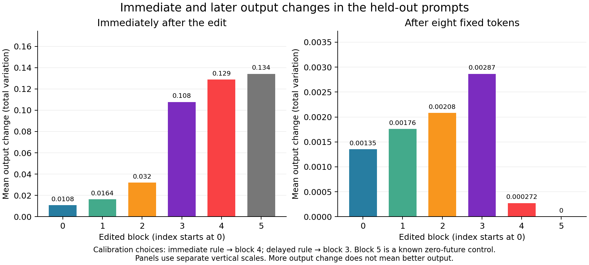

# Selecting a patch site for a later output effect

**A fixed Pythia-14M test with shared continuation tokens**

13 October 2026. AI-authored research note. The plan and runner were published before measurement. A separate AI model replay passed. No human review has occurred.

## Abstract

An internal edit can change a model's next prediction and its later predictions by different amounts. We tested whether the immediate change selects a useful site for a later output-change test. We replaced one prompt-state vector in Pythia-14M, then gave the edited and unedited model the same eight tokens. We selected a layer using four calibration word pairs and tested it on four new pairs. The immediate score selected block 4. The score after eight tokens selected block 3. On the new words, their mean later output changes were 0.000272 and 0.002866, respectively. The fixed primary difference was 0.002594 on a scale from 0 to 1. All cache, self-replacement, and full-recomputation controls passed. The model did not place the requested copy target first on any of the 64 prompts. Thus this is evidence about generic output sensitivity, not correct copying or useful memory. The result supports matching the patch-site score to the time point of interest in this small, fixed test.

## 1. Why the time point matters

Activation patching replaces an internal value in one model run with a value from another run. Researchers then measure the output change. The choice of output score is part of the method, as discussed by [Heimersheim and Nanda (2024)](https://arxiv.org/abs/2404.15255v1).

For a language model, there is more than one output time point. A prompt-state edit can change the next-token distribution directly. It can also change the stored keys and values that later tokens use. These two routes need not favor the same layer.

The second route is established prior work. [Belitsky et al. (2025)](https://arxiv.org/abs/2507.08799v2) study one-time cache steering. [Kang et al. (2026)](https://arxiv.org/abs/2605.10664v2) study the reuse of steered states and resulting cache contamination. [Liu et al. (2026)](https://arxiv.org/abs/2605.06225v2) place text-derived cache banks at selected layers. [Li (2026)](https://arxiv.org/abs/2606.17107v1) studies information written into downstream cache states during prefill. We do not claim to discover cache persistence.

Our question is narrower: does a layer selected for its immediate effect also produce a large later effect on new words? We use a fixed common continuation so that a difference in generated tokens cannot explain the comparison. The contribution is this complete, held-out benchmark. It is not a new steering method.

## 2. The fixed experiment

We used the six-block Pythia-14M checkpoint at revision `cf967c0a9a04383db6f7b1108d86b2962634b4ac`. The model family is described by [Biderman et al. (2023)](https://arxiv.org/abs/2304.01373v2). The later 14M checkpoint is specified by its [own model files](https://huggingface.co/EleutherAI/pythia-14m/tree/cf967c0a9a04383db6f7b1108d86b2962634b4ac). We did not train or tune the model.

The sample contained four prompt frames. One example was `The entry is fox. Copy the entry:`. The other frames used *code*, *password*, or *label* in place of *entry*. We paired words and used each pair in both directions. The calibration pairs were fox/wolf, tree/leaf, glass/plate, and rock/sand. The test pairs were gold/silver, door/wall, road/path, and fire/wind. Each set had 32 directed cases. All frames and both directions for one word pair stayed in the same set.

For each case, the receiver prompt had one word and the donor prompt had the paired word. The prompts had the same token length and differed at one token. Both ended in the same token. At one block, we replaced the receiver's final prompt-position vector with the donor's vector after that block. We used a complete vector replacement. We made no later activation edit.

The model stored its key-value cache during this prompt pass. We then fed both branches these exact eight token pieces: ` The`, ` record`, ` will`, ` be`, ` checked`, ` again`, ` after`, ` this`. Their IDs were fixed before the run. The model did not choose them. We measured the next-token distribution immediately after the prompt and after each supplied token. This is a controlled continuation, not free generation or a natural copy-answer trial.

The primary score was **total variation distance**, abbreviated TV. It is half the sum of absolute differences between the two probability distributions across all 50,304 output tokens. Zero means the distributions are identical. One is the largest possible difference. Larger TV means more output change; it need not mean a better output.

We compared two layer-selection rules. The immediate rule chose the block with the largest calibration mean TV before the suffix. The delayed rule used calibration mean TV after all eight tokens. The fixed primary endpoint was the difference between those blocks' later mean TV on the 32 test cases. Only blocks 0–4 were candidates. We fixed ties within `1e-10` in favor of the smaller index. We fixed `1e-8` as the numerical-negligibility label. No test result was used to choose a layer.

Block 5 was a control. Its attention cache is written before its post-block output. An edit after this last block therefore cannot change any cache entry. If later tokens are held fixed, later predictions must match the baseline. This is an architectural fact, not a new result.

The [full plan](analysis-plan.md) and [runner](code/run.py) were locked at commit [`512fdba`](https://github.com/gavenren/mechanistic-interpretability-research/commit/512fdba309df32aa3a98db59c65ec5d5d383635f). All cases and all layers were retained. There was no capability screen.

## 3. The two rules selected different blocks

The immediate rule selected block 4. The delayed rule selected block 3. The same ordering held at their respective time points in the test set.

| Edited block | Calibration: immediate TV | Calibration: later TV | Test: immediate TV | Test: later TV |
|---|---:|---:|---:|---:|
| 0 | 0.006069 | 0.000684 | 0.010802 | 0.001353 |
| 1 | 0.014373 | 0.001312 | 0.016375 | 0.001758 |
| 2 | 0.026524 | 0.001595 | 0.031951 | 0.002079 |
| 3 | 0.116438 | **0.002828** | 0.107715 | **0.002866** |
| 4 | **0.145107** | 0.000337 | **0.128748** | 0.000272 |
| 5: control | 0.153289 | 0 | 0.134197 | 0 |

“Later” means after the fixed eight-token suffix. Each mean uses 32 directed cases. Block 5 is excluded from both selections.

The fixed primary difference was **0.00259354** in favor of the delayed rule. This is an absolute difference in output distributions, not a gain in task accuracy. Both later effects were small on the 0-to-1 scale. The uniform mean across the five candidate blocks was 0.00166569, between the two selected blocks.

*Figure 1. The two panels use different vertical scales. Each bar averages the same 32 test cases. The block choices came only from calibration. Larger bars do not mean better answers.*

The primary difference was positive in each of the four test word-pair groups and each frame group. The groups share prompts and are not independent replications.

| Test group | Cases | Block 4: later TV | Block 3: later TV | Difference |
|---|---:|---:|---:|---:|
| gold/silver | 8 | 0.000238 | 0.002663 | 0.002425 |
| door/wall | 8 | 0.000276 | 0.002637 | 0.002361 |
| road/path | 8 | 0.000334 | 0.003197 | 0.002863 |
| fire/wind | 8 | 0.000240 | 0.002965 | 0.002725 |
| entry frame | 8 | 0.000256 | 0.003304 | 0.003048 |
| code frame | 8 | 0.000154 | 0.001902 | 0.001748 |
| password frame | 8 | 0.000260 | 0.003321 | 0.003061 |
| label frame | 8 | 0.000417 | 0.002935 | 0.002518 |

The mean raw residual-change norm in the test set was 0.1848 at block 3 and 0.2460 at block 4. The corresponding mean changes relative to the receiver vector norm were 0.1526 and 0.1636. Thus the larger later effect did not simply accompany a larger raw edit in this pair of blocks. However, norms at different layers do not standardize the interventions. We did not match their sizes or isolate the cause of the ranking change.

The full horizon profile was not a smooth decline. For example, block 4's test mean TV rose from 0.000793 after token 6 to 0.006437 after token 7, then fell to 0.000272 after token 8. Both the position and the supplied content changed. This profile must not be read as a pure rate of memory decay. All nine horizons are in the [complete group table](results/group-summary.csv).

## 4. The model did not solve the copy task

The requested receiver word was never the model's highest-probability next token: 0 of 32 calibration prompts and 0 of 32 test prompts. Its logit exceeded the paired donor word's logit in 30 calibration cases and 23 test cases. These are different measures. A preference between two target words does not establish correct copying across the full vocabulary.

This limit is central. The copy-style frames supply controlled word contrasts, but they do not give us ground truth for a working copy circuit in this model. The experiment tests how an internal replacement changes distributions. It does not identify a correct stored answer, a semantic register, or a useful memory edit. [Shih, Winnicki, and Darve (2026)](https://arxiv.org/abs/2606.29522v2) explain why a changed output is insufficient evidence that later computation uses an edited state according to its meaning.

## 5. Controls identify the execution path

Each continuation started from a fresh copy of its prefill cache. Each edit hook ran once at the original final prefix position. No hook was active on incremental suffix steps. The full recomputation check used the receiver prefix plus the same suffix tokens, and edited only that original position.

| Logit check | Comparisons | Largest absolute error |
|---|---:|---:|
| Baseline cache versus full recomputation | 576 | 3.7432 × 10⁻¹¹ |
| Patched cache versus full recomputation | 3,456 | 3.7596 × 10⁻¹¹ |
| Self replacement versus baseline | 3,456 | 0 |
| Reset to baseline cache | 3,072 | 0 |
| Block-5 edit at later horizons | 512 | 0 |

Each comparison used every output logit. All 11,072 comparisons passed the fixed `1e-8` bound. All 9,216 cache checks passed exact equality at the positions that had to remain unchanged. These checks include both self replacements and donor replacements. They are checks of groups of cache values, not counts of individual scalar entries.

The reset result means that no later difference remained when the patched cache was discarded and the unchanged cache was restored. The cache-boundary checks also matched the architecture: the edit left the edited block's cache and all earlier blocks' caches unchanged. The terminal control had exactly zero later effect. These checks support the intended cache route in this implementation. They do not identify which later head or cache coordinate caused the measured effect.

We used float64 parameters and arithmetic, including attention softmax. The stock rotary tables still used float32 arithmetic. These tables were shared by all branches. This is not a fully float64 ground truth. Finite-precision cache and recomputation paths can differ, as examined in a different setting by [Chodavarapu and Xu (2026)](https://arxiv.org/abs/2604.15409v1). We therefore measured agreement instead of assuming it.

## 6. What this result supports

In this fixed test, the layer with the largest immediate effect among the eligible sites did not have the largest effect eight tokens later. A rule aimed at the later time point selected a different layer, and that selection carried over to the new words.

For a study whose question concerns later output, this example supports measuring later output during site selection. It also shows why a one-time prompt edit must be distinguished from a hook that keeps acting during decoding. A fresh-cache reset and full-prefix recomputation make that distinction testable.

The experiment does not show that larger later TV is desirable. It does not show that an edit persists in a semantically correct form. It does not estimate how often immediate rankings fail in other models. The evidence covers one tiny checkpoint, four related frames, four held-out word pairs, one suffix, and eight supplied tokens. We did not test free generation, longer dialogue, matched edit sizes, task-trained models, or alternative cache sites. The forced suffix is not a natural answer to the copy prompt. A new suffix or a model that can perform the task could give a different ordering.

## 7. Reproduction and review

The scientific run used 14,592 model forward calls and took 90.32 seconds on an arm64 CPU with two PyTorch threads. It had a fixed 20-minute limit. The call count includes both selectors, all test measurements, and all controls. It is not a claim of inference savings.

The [README](README.md) gives the commands. The [input ledger](results/inputs.json) fixes every prompt and token ID. The [score table](results/scores.csv) contains all 3,456 case × block × horizon measurements. The repository also includes all baseline scores, cache and logit checks, hook-call records, saved post-block vectors, model hashes, package versions, and a [file manifest](results/manifest.json). Full-vocabulary tensors are not stored, but the pinned model and code permit a complete replay. The weights remain available from their fixed upstream revision; the download script checks their hashes.

The [pre-run review](reviews/pre-run-review.md) and [independent audit](reviews/independent-audit.json) were done by a separate AI agent. The audit did not import the runner. It used 4,096 model calls to recompute every full prefix without a cache, check all 3,456 TV rows, and check the saved vectors. The largest TV difference was `5.6122e-13`. The largest target-logit difference was `2.1105e-11`, below the fixed `1e-8` bound. The saved post-block vectors matched exactly. All group and selector arithmetic matched. This replay took 31.82 seconds in addition to the main run.

The [final AI review](reviews/result-review.md) also checked the text and figure against the saved results. No human peer review or external replication has occurred. The [source ledger](sources.md) records the close prior work and the limits of the novelty claim.
