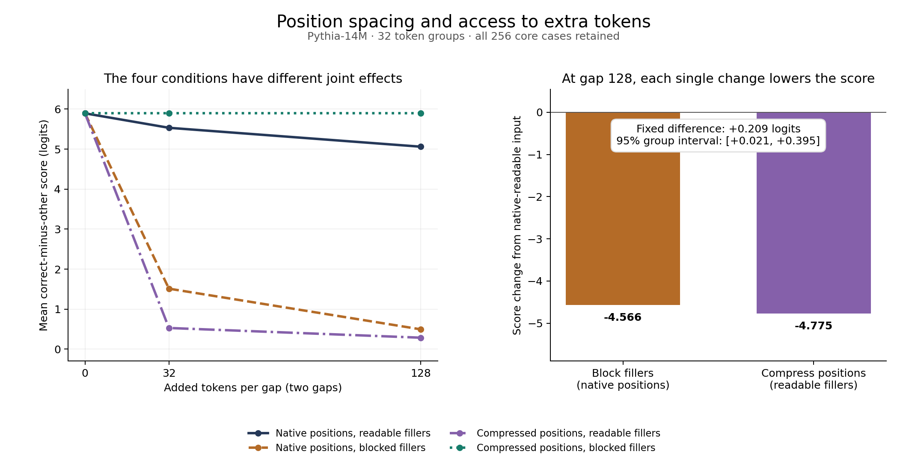

# A joint test of position spacing and access to extra tokens in Pythia-14M

**Date:** 13 October 2026.  
**Status:** completed fixed experiment with a separate AI audit. AI-authored. No human peer review.  
**Model:** one pinned Pythia-14M checkpoint.  
**Public plan and code lock:** [`c6ff9cb1405e6a65fe161c2f4cb471d51016bf4c`](https://github.com/gavenren/mechanistic-interpretability-research/tree/c6ff9cb1405e6a65fe161c2f4cb471d51016bf4c/studies/2026-10-13-position-access).

## Abstract

Extra tokens change both what a model can read and the distance between useful tokens. We test these factors together in a small trained model. The task gives two key–value pairs and then repeats one key. We cross two changes: block access to extra filler tokens, or compress the position coordinates used by attention. The physical token sequence stays fixed. At the largest gap, either single change sharply lowers the score for the correct value. Blocking fillers lowers it by 4.566 logits; compressing positions lowers it by 4.775. Their fixed difference is 0.209 logits, with a 95% group interval of [0.021, 0.395]. This ranks two harmful changes. It does not identify a useful repair. Applying both changes matches the short-input control, as expected from the construction. Scores and outputs also differ: the normal long input has a lower mean score than the short input, yet its full-vocabulary top-1 accuracy rises from 23.83% to 33.20%. The result supports a joint, bounded test of these artificial interventions. It does not separate pure distance decay from pure attention competition.

## 1. Question and relation to earlier work

Suppose a model sees a key followed by a value, then must use that binding when the key appears again. Adding tokens between the source and query changes several things. It increases their position distance. It also adds material that attention can read, which can change later representations. A simple length comparison does not separate these changes.

We test whether two model changes can help explain the score difference: make filler tokens unreadable, and compress the position coordinates. We apply each change alone and both together. The important comparison keeps the full token tensor fixed.

These methods have close prior work. CALIOPE changes rotary positions during inference and tests retrieval with distractors. Huang and colleagues distinguish phase edits with fixed features from real prompt changes that alter contextual features. Enouen and Galhotra study retrieval mechanisms across position encodings. Bayram uses head and rotary-frequency interventions. We do not introduce position calibration or causal testing of retrieval heads. [Zehle and Aßenmacher](https://aclanthology.org/2026.findings-eacl.120/); [Huang et al.](https://arxiv.org/html/2609.14127v1); [Enouen and Galhotra](https://arxiv.org/html/2609.38530v1); [Bayram](https://arxiv.org/abs/2606.21249).

Our contribution is one fixed crossed test with exact short-input controls. It measures how the two interventions interact in one checkpoint. A focused source search found no exact match to this complete test. That does not prove novelty. The [source record](sources.md) states what was checked.

## 2. Method

### Model and task

We use `EleutherAI/pythia-14m` at revision `cf967c0a9a04383db6f7b1108d86b2962634b4ac`. We verify model, configuration, tokenizer, and card hashes. The model has six blocks, four attention heads per block, and width 128. It runs without training, on a CPU with two threads.

We use double arithmetic, including attention softmax. The stock rotary calculation still uses float32 position and trigonometric tables. This is not an entirely float64 model calculation. The reference passes use the same numerical condition.

The fixed token rule selects single tokens that decode to a space followed by 3–8 lowercase letters. We use 32 groups of four new key/value tokens, separate from the earlier copy study's token pool. Every group has two bindings, two pair orders, and two queries. This gives 256 core cases. Each case uses two equal filler gaps of 0, 32, or 128 tokens. The complete input has 6, 70, or 262 tokens:

`BOS, key1, value1, gap1, key2, value2, gap2, query`.

The answer is the value supplied for the query key. Both assignments and both orders are balanced. All 768 input variants remain in the results. No outcome from this study was used to select inputs or a head.

### Four conditions

The normal condition uses native position indices and readable filler tokens. The position change compresses the six core tokens to coordinates 0 through 5. Fillers receive ordered fractional coordinates between them. The access change blocks every filler key column in attention, at every layer and head. Physical causal order remains unchanged. BOS remains available, so no attention row is empty.

| Position coordinates | Filler access | Meaning |
| --- | --- | --- |
| Native | Readable | Normal long input |
| Native | Blocked | Sparse core positions with no filler-mediated path |
| Compressed | Readable | Dense filler content in a short coordinate span |
| Compressed | Blocked | Equivalent to the six-token short input |

Blocking filler keys prevents every token from reading them in every layer. It therefore removes all later effects of reading fillers. It does not remove only their share of an attention denominator. Likewise, changing coordinates can change later contextual features. The compressed-readable condition is artificial and is not proposed as a production method.

### Outcomes and fixed comparison

The binding score is the correct value's logit minus the other supplied value's logit. A logit is a score before conversion to probabilities. We also report whether the correct value beats the other value, and whether it is the highest-scoring token in the complete vocabulary.

The sole primary comparison is at gap 128: native-blocked score minus compressed-readable score. This is also the difference between the two proposed single-change repairs. We average each group's eight cases, then average the 32 groups. The 95% interval uses 10,000 resamples of complete groups with fixed seed `2026101403`. It describes variation under this construction, not all language use or models.

As a secondary test, we remove only zero-based block 3, head 1's final-query output before output projection. This head was selected in the earlier [copy-routing study](../2026-10-13-copy-routing/paper.md). The same zero operator is applied to every cell. No new head search occurs. This test measures one local contribution; it does not recover a complete circuit.

## 3. Results

### Both single changes reduce the score

At gap 128, the normal long input has mean score 5.061. Blocking fillers alone reduces this to 0.495. Compressing positions alone reduces it to 0.286. The fixed contrast is **0.209 logits**, with interval **[0.021, 0.395]**. It has the declared positive sign, but both changes are harmful relative to the normal long input. The access change is less harmful by this metric. It is not a successful repair.

| Condition at gap 128 | Mean score | Correct value beats other value | Correct top token in full vocabulary |
| --- | ---: | ---: | ---: |
| Native, readable | 5.061 | 90.23% | 33.20% |
| Native, blocked | 0.495 | 53.91% | 0.00% |
| Compressed, readable | 0.286 | 54.30% | 0.00% |
| Compressed, blocked | 5.895 | 94.92% | 23.83% |

The primary difference is positive in 22 of 32 token groups. Group differences range from −1.535 to 2.094 logits. The average does not imply that blocking fillers is the less harmful change for every group.

### The normal long input loses score but gains top-1 accuracy

The normal short input has mean score 5.895, two-answer accuracy 94.92%, and full-vocabulary top-1 accuracy 23.83%. At gap 128, the normal score falls by 0.835 logits and two-answer accuracy falls to 90.23%. Yet full-vocabulary accuracy rises to 33.20%: 85 correct top predictions rather than 61.

These measures answer different questions. The margin compares only the two supplied values. Full-vocabulary accuracy compares the correct value with every token. The experiment found a mean score decline, not a general decline across all output measures. Restoring the short-input score with both changes also restores its lower top-1 rate.

### The two changes have a large secondary interaction

| Tokens per gap | Native, readable | Native, blocked | Compressed, readable | Compressed, blocked |
| --- | ---: | ---: | ---: | ---: |
| 0 | 5.895 | 5.895 | 5.895 | 5.895 |
| 32 | 5.533 | 1.511 | 0.529 | 5.895 |
| 128 | 5.061 | 0.495 | 0.286 | 5.895 |

The two single changes do not predict their joint result by simple addition. The planned secondary interaction is 9.388 logits at gap 32 and 10.175 at gap 128. It is the native-readable score minus the two single-change scores plus the combined-change score.

The combined condition matches the short input because the construction makes them equivalent. That is an expected control, not a new discovery. The empirical result is the large score loss from each single change and its size relative to that control. This limits a simple additive explanation of the long–short score difference in this grid. It does not establish a new general principle of interaction.

### The preselected head's effect also changes

At gap 128, removing the selected head lowers the score by 2.949 logits in the native-readable condition. Its effect is only 0.161 with fillers blocked at native positions, and 0.167 with readable fillers at compressed positions. With both changes, its effect is 3.214, matching the short-input value.

Its attention also changes. In the native-readable condition, it gives the target value 44.54% of its final-query attention. This falls to 6.47% in the native-blocked condition and 2.08% in the compressed-readable condition. The latter gives fillers 85.86%. These attention shares are descriptive. The ablation supplies the separate causal evidence. Neither measure establishes a pure distance or competition mechanism.

## 4. Verification and cost

The locked run saved all 6,144 scored intact/ablated examples. Controls raised total work to 16,896 forward examples in 4,224 calls. The run took 181.2 seconds with two CPU threads and batch size four, below the fixed 20-minute cap. No paid inference or model training was used.

All 12,800 logit/state comparisons and 4,224 attention checks passed. Maximum all-vocabulary logit error was `2.40e-11`, below `1e-8`. Maximum core-state error was `8.44e-13`, below `1e-10`. Maximum attention row-sum error was `2.45e-15`, below `1e-12`. Required masked weights and untouched local output changes were exactly zero.

The controls cover both blocked cells, with and without head removal. Native-blocked execution matches an actual six-token input at sparse native coordinates. Compressed-blocked execution matches the ordinary six-token input. Changing all filler identities in the blocked cells leaves core states and logits unchanged within the fixed tolerances. The native-readable cell matches the default causal-mask reference. Every cell also has a no-op head check. The [control summary](results/control-summary.json) links these statements to saved records.

A separate AI audit rebuilt all 768 inputs and checked all saved arithmetic. It replayed all 6,144 scored examples with a separate projection-input hook for the head ablation. Every full-vocabulary output hash matched exactly. It also checked all 3,072 blocked examples against the corresponding short inputs. Their maximum logit and core-state errors were the same small values reported above. The audit used 2,304 calls and 9,216 forward examples, taking 90.6 seconds in addition to the main run. The [audit receipt](reviews/independent-audit.json) records its full scope. The scientific plan, runner, and results were not changed.

## 5. Limits and use

This is one small checkpoint and one artificial binding task. The maximum length is 262 tokens. It is not a test of frontier long-context systems. Both interventions act throughout the model. They do not hold later query/key content fixed or isolate one softmax effect.

Fillers are not necessarily inert distractors. Reading them can support later computation. Blocking them removes that support as well as any competition. The compressed-readable condition also creates unusual geometry. The result does not imply that filtering distractors or changing position encodings is generally harmful.

The useful lesson is procedural and bounded: when testing position and context explanations, preserve the four crossed conditions and check exact short-input equivalents. Keep score changes separate from full-vocabulary behavior. Here, neither single edit repaired the score, their joint effect was strongly non-additive, and the natural score decline coexisted with improved top-1 accuracy.

## Technical record

The [fixed plan](analysis-plan.md) defines every token rule, seed, coordinate, mask, tolerance, and stopping condition. The [input ledger](results/inputs.json), [per-case results](results/scores.csv), [group contrasts](results/group-contrasts.csv), and [summary](results/summary.json) preserve the full grid. The [README](README.md) gives reproduction commands. This is AI-authored research with separate AI review, not human peer review.
