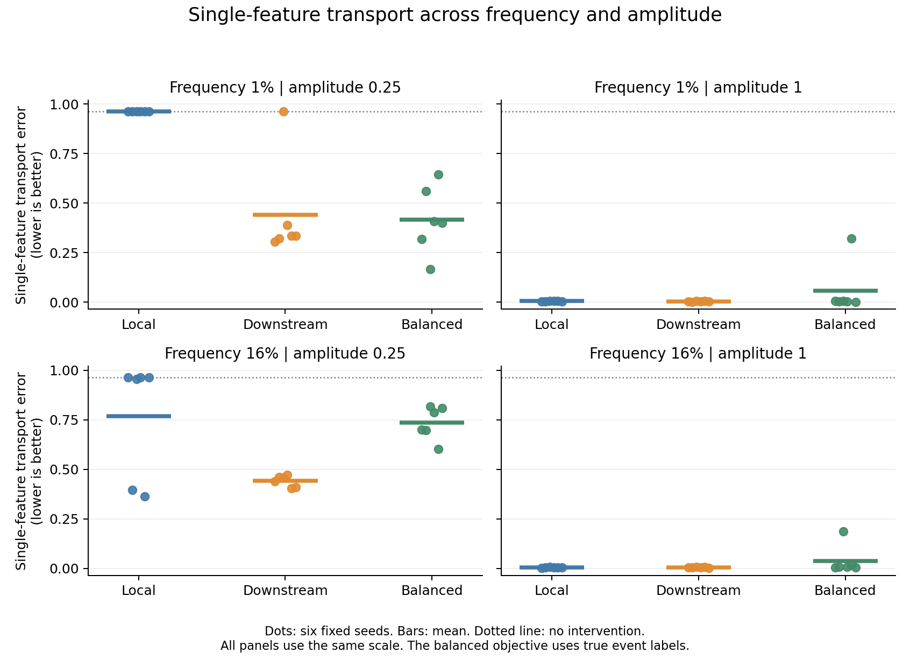

# Rare-event weighting does not reliably isolate one causal feature

*A controlled study of sparse autoencoders, feature amplitude, and causal interventions*

13 October 2026 · Research note · AI-assisted research and writing · Not peer reviewed

## Abstract

Giving rare examples more weight did not reliably improve a single learned feature in our main test. We trained 72 small sparse autoencoders under a fixed plan. Each autoencoder rebuilt a vector from at most four active learned features. A specified output rule read one task-relevant feature from that vector. We varied the feature's frequency and amplitude while holding its true effect on the output constant. We compared reconstruction training, training that also preserved the output, and training that gave equal weight to rare and common output cases. The last method used true event labels and was an oracle comparison. In the main condition, its mean improvement over ordinary output-preserving training was 0.024 on a probability-error scale. However, it was worse in five of six paired runs. The bootstrap interval was −0.206 to 0.344. Its full code transported the required output change much better than its best validation-selected single feature. These results distinguish preserving a useful joint code from isolating a useful causal feature. They apply to this small generator and training schedule, not to language models in general.

## 1. The question

A sparse autoencoder, or SAE, rebuilds an internal vector from a few learned features. A good reconstruction is useful, but it does not show that a particular feature carries the computation of interest. Previous work already makes this distinction. End-to-end SAE training includes the model's output in the training objective, while synthetic benchmarks compare learned features with known generating features. [Braun et al., 2024](https://arxiv.org/abs/2405.12241); [Chanin and Garriga-Alonso, 2026](https://arxiv.org/abs/2602.14687).

We ask a narrower question. If the important event is rare, does giving its output error more weight help an SAE place the event's causal effect in one usable feature? More weight might improve task preservation while spreading the relevant signal across several learned features. An average reconstruction score would not settle that question.

The broad problem is established. Bal tests cases where good decoder alignment does not imply the expected causal use. Hoang and colleagues study how a feature's output effects vary across contexts. Our contribution is a new, fixed comparison across event frequency, activation amplitude, and training objective. We do not claim a new SAE architecture or the first causal evaluation of SAE features. [Bal, 2026](https://arxiv.org/abs/2607.12166); [Hoang et al., 2026](https://arxiv.org/abs/2607.24645).

## 2. A task with a known causal effect

We generated 12-dimensional vectors. Twenty sparse background features occupied an 11-dimensional subspace. One perpendicular direction represented the task event. Its value was either zero or a fixed amplitude. Making this direction perpendicular removes ambiguity about whether the event is present in the original vector. This is a deliberate simplification.

The output rule was specified by hand. It read only the event direction and returned a binary probability. The event changed that probability from about 0.018 to 0.982. Thus its true effect was always about 0.964, including when its activation amplitude was small. We trained the SAE, not this output rule.

The fixed experiment crossed two frequencies, 1% and 16%, with two amplitudes, 0.25 and 1. Each of six replication seeds set a background dictionary, data, and initial SAE weights. Every condition had three training objectives, giving 72 models. Within a seed and condition, the objectives used identical data, initial weights, and minibatch sequences.

Each training set contained 10,000 draws, with exactly 100 or 1,600 event cases. Each validation set had 1,024 new background draws. Each test set had 2,048 further draws. We evaluated every validation and test background both with and without the event. The test therefore had 2,048 event cases even for the 1% condition. Natural-distribution metrics used the stated frequency to weight the two groups.

Draw identities were separate across splits. Input values could repeat. In particular, the generator produced an all-zero background with probability about 12.2%. This was the only exact shared background value across split pairs in all six generated problems. Test zero-background counts ranged from 230 to 268. These are held-out draws, not a claim that every test vector was unseen.

## 3. Three training objectives

We call each learned feature coordinate a latent. Every model had 24 latents and retained at most four positive activations per example. We used TopK, an established way to set a sparse code budget. A fixed budget does not guarantee correct feature recovery, so we also recorded actual activity. [Gao et al., 2024](https://arxiv.org/abs/2406.04093); [Chanin and Garriga-Alonso, 2026](https://proceedings.mlr.press/v306/chanin26a.html).

| Objective | What training rewards |
| --- | --- |
| Local | Small squared reconstruction error |
| Downstream | Reconstruction plus agreement with the specified output rule |
| Balanced | The same two terms, but rare and common cases get equal total weight in the output term |

The reconstruction term kept its natural frequency weights in all three methods. The output term had coefficient 0.1. Balanced training required the true event labels. It is an oracle comparison, not a fair claim of improvement over unsupervised learning without added information. All methods also received labelled counterfactual validation pairs to select their best candidate latent.

Training used 4,000 Adam steps with batches of 128 and learning rate 0.005. Decoder directions had unit length after each update. There was no feature resampling, extra training for poor runs, or replacement of seeds. The [locked plan](analysis-plan.md) and [runner](code/run.py) specify all settings. Their [lock commit](https://github.com/gavenren/mechanistic-interpretability-research/commit/75ab86efd6159a4965b8461a534a0a29592d98ac) was published before training.

## 4. Test the learned feature by changing it

For each background, we encoded the event-absent and event-present vectors. We then changed the contribution of one learned latent in the **original vector**. We kept the rest of the original vector, including the SAE's reconstruction error, fixed. The output should change to the correct counterfactual probability. We tested both directions: absent to present and present to absent.

For latent j, the intervention was:

`patched original = original receiver + (donor code[j] − receiver code[j]) × decoder[j]`.

We averaged the absolute probability error in the two directions. Zero means the required output change was correct. No intervention gives error about 0.964. This test asks whether one decoded contribution can transport the specified change. It does not establish recovery of a complete internal mechanism.

We selected the best latent using validation pairs alone. We then froze that choice and measured test error. We also replaced the complete code, using the same original-vector intervention. Separate tests applied replacements inside the SAE reconstruction. Those secondary tests include reconstruction error and answer a different question.

A one-latent replacement can produce a code with five active entries, even though the encoder permits at most four. We recorded this and did not apply TopK again after replacement. The original-vector intervention also retains the receiver's residual, so it is not merely a sparse reconstructed vector.

## 5. Main result: a small average benefit, with no reliable gain

The primary condition was fixed in advance: 1% frequency and amplitude 0.25. The primary contrast was ordinary downstream error minus balanced error. Positive values favour balancing.

| Seed | Ordinary downstream error | Balanced error | Difference |
| --- | ---: | ---: | ---: |
| 0 | 0.3040 | 0.3198 | −0.0158 |
| 1 | 0.3203 | 0.5620 | −0.2416 |
| 2 | 0.9639 | 0.1674 | +0.7966 |
| 3 | 0.3888 | 0.4083 | −0.0195 |
| 4 | 0.3361 | 0.6448 | −0.3087 |
| 5 | 0.3350 | 0.4013 | −0.0663 |
| **Mean** | **0.4414** | **0.4173** | **+0.0241** |

Balanced training was worse in five runs and much better in one. That one improvement made the mean positive. The median difference was −0.0429. The 95% paired bootstrap interval for the mean was −0.2056 to 0.3443, using the six replication seeds. It does not cover uncertainty across architectures or tasks.

The planned directional prediction is therefore not supported reliably. The result does not establish equality either. The available seeds show a large and uneven response to the extra weighting.

## 6. The joint code and the single feature give different answers

The balanced method had a clearer advantage when the complete code was replaced in the primary condition. Its mean error was 0.1183, compared with 0.4414 for ordinary downstream training. Its selected single latent had error 0.4173. The joint code therefore carried much more usable change than that one selected latent.

| Primary-condition metric | Local | Downstream | Balanced |
| --- | ---: | ---: | ---: |
| Single-latent error in original vector | 0.9640 | 0.4414 | 0.4173 |
| Full-code error in original vector | 0.9639 | 0.4414 | 0.1183 |
| Full-code error in reconstruction | 0.4821 | 0.2221 | 0.0768 |
| Natural-weighted reconstruction error | 0.1305 | 0.1301 | 0.1518 |
| Natural-weighted downstream KL | 0.03795 | 0.01797 | 0.06307 |
| Same-label single-latent output change | 0.00025 | 0.0933 | 0.0911 |

Balanced training did not improve every output measure. Its naturally weighted downstream KL, which measures disagreement with the original output distribution, was larger than both other methods. Better full-code intervention performance did not mean better average output preservation.

This comparison supports a narrow conclusion: output-preserving training and single-feature localization are separate goals in this setup. It does not identify why the code spread or combined the signal. Interactions, feature mixtures, and optimization differences need separate tests.

The same-label control also matters. We swapped the chosen latent between different backgrounds while keeping the event label fixed. The correct output should stay unchanged. Both downstream methods caused mean changes near 0.09. These effects show that a useful event intervention did not make the selected latent free of background dependence. The local method's small change is not evidence of success: it also failed to move the event output.

## 7. Frequency alone does not explain the result

The complete fixed comparison is below. Each entry is the mean selected single-latent error across six seeds.

| Event frequency | Amplitude | Local | Downstream | Balanced |
| --- | ---: | ---: | ---: | ---: |
| 1% | 0.25 | 0.9640 | 0.4414 | 0.4173 |
| 1% | 1.00 | 0.0051 | 0.0045 | 0.0574 |
| 16% | 0.25 | 0.7680 | 0.4416 | 0.7360 |
| 16% | 1.00 | 0.0050 | 0.0054 | 0.0383 |

*Dots show seed outcomes; bars show their means. The dotted line is the no-intervention error. All panels use the same scale.*

At 1% frequency, local reconstruction error was similar for amplitudes 0.25 and 1: 0.1305 and 0.1298. Yet feature-transport errors were 0.9640 and 0.0051. Average reconstruction quality did not reveal this large difference.

Two conditions also had the same expected squared event signal, `frequency × amplitude² = 0.01`: a rare large event and a more common small event. Their local errors were 0.0051 and 0.7680. Equal average signal energy did not imply equal learned feature transport. This is a descriptive comparison of this optimizer and generator, not a general law about feature learning.

## 8. What the study establishes, and what it leaves open

The study gives a reproducible example in which an explicit effort to preserve rare outputs improves a joint representation without reliably isolating one useful causal feature. It also shows why a mean result and a reconstruction score should not substitute for the declared intervention test.

The limits are substantial. The task used one hand-specified output rule and a feature direction made orthogonal to background features. There was no pretrained language model. The balanced objective had labels. A single latent may be the wrong unit for a distributed representation. We fixed one SAE width, sparsity budget, loss coefficient, and training schedule. More training or another architecture could change the outcome. Repeated zero inputs mean the test is not purely about unseen values. Six replication seeds support a bounded comparison, not a population-wide rate of failure.

All 72 planned runs were retained. Before training, finite-difference checks covered 32 parameter coordinates for each objective. Maximum scaled gradient error was below 1.9×10⁻⁹. Identity, empty, full-code, and known-direction controls passed. The locked code and plan did not change during the run. Training and evaluation took about 60 seconds on the recorded computer.

A separate AI agent performed an [independent calculation review](reviews/independent-review.md). It checked all 72 models and 3,456 candidate rows, with a maximum numerical difference of 5.11×10⁻¹⁴ across 2,696,520 values. This was an AI calculation review, not human peer review.

The [reproduction guide](README.md), [source ledger](sources.md), [complete latent scores](results/all-latent-scores.csv), [selected results](results/selected-latents.csv), [paired contrasts](results/paired-contrasts.csv), and saved weights allow direct checks. This is a research note with a mixed primary result. It is not evidence that label balancing always fails, or that SAEs cannot recover rare causal features.
