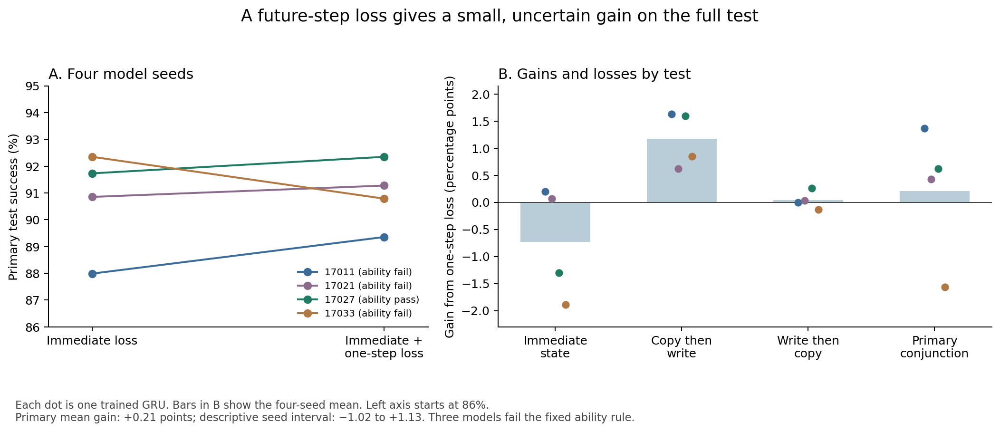

# A small, uncertain gain from training state edits on one future step

**13 October 2026. AI-authored controlled study. No human review.** The [plan, code, and inputs were fixed in a public commit](https://github.com/gavenren/mechanistic-interpretability-research/commit/1ff6f252c4d11ac9e0cc2e778e0a6157fabd81e4) before training or test outputs. This report concerns small recurrent models trained for an exact task. It is not evidence about language models.

## Abstract

A hidden-state edit can change a model's current answer without giving it a state that it uses correctly later. We test this issue with two registers, A and B. An edit changes A. If the model copies A into B and then replaces A, B must keep the edited value. If the model replaces A and then copies A into B, both registers must lose the old edit. We compare the same four-dimensional edit trained with an immediate-output loss or a loss that also includes one future operation.

Across four model seeds, the two losses passed the full test in 90.73% and 90.94% of cases. The gain was **0.21 percentage points**, with a descriptive four-seed interval of **−1.02 to +1.13 points**. Three seeds improved and one declined. The future-step loss improved the copy-then-write endpoint by 1.17 points, but reduced immediate accuracy by 0.73 points. Three models missed the fixed 99% task-ability rule. Thus, the result does not establish a reliable advantage for the added loss. It shows why immediate success, later propagation, and release after replacement need separate checks.

## 1. What the test asks

Suppose A holds 0 and B holds 1. We edit A to 2, then use the new write value 3. The model must now give different answers for two orders of the same operations:

| Operation order | After the first operation | After the second operation |
|---|---|---|
| Copy A into B, then write 3 into A | A=2, B=2 | A=3, B=2 |
| Write 3 into A, then copy A into B | A=3, B=1 | A=3, B=3 |

The first order tests whether the edit moves into B and survives there. The second tests whether a new write removes the edit. Always retaining the edited value would fail the second order. Always removing it would fail the first.

Our primary score requires a correct immediate joint state and correct final states in both orders. We also record both first-step outputs. They are not part of the primary score. Passing the primary score therefore does not mean that every intermediate output is correct.

## 2. Relation to prior work

The distinction between an immediate steering effect and state used in later computation is established. Shih, Winnicki, and Darve test downstream state use, continuation controls, and persistence in controlled tasks. Liu and Chen test one-time low-rank edits followed by autonomous rollouts, with specificity and native counterfactual controls. Our contribution is the fixed copy/write order test and a small comparison of two losses. It is not a new principle of causal state. [Shih et al., version 2](https://arxiv.org/abs/2606.29522v2); [Liu and Chen, version 4](https://arxiv.org/abs/2608.15156v4).

The edit uses the established idea of replacing coordinates in a learned subspace. Distributed Alignment Search studies such alignments. Other work also changes training objectives for more faithful interchange edits. Our method comparison is narrower than either general problem. [Geiger et al., 2024](https://proceedings.mlr.press/v236/geiger24a.html); [Bao et al., version 2](https://arxiv.org/abs/2602.05234v2).

Recurrent models can store sequence information in nonlinear forms. A failure of our linear, rank-four edit would not prove that the model lacks a usable register state. [Csordás et al., 2024](https://aclanthology.org/2024.blackboxnlp-1.17/). The [source record](sources.md) states the checked versions and overlap. The search does not prove novelty.

## 3. Method

Each register holds one of four values. An exact state machine has 14 operations: write a chosen value into either register; copy either register into the other; increment either value modulo four; swap them; or do nothing. Both registers start at zero. The model receives operations only. It predicts one of 16 joint states after each operation. It never receives its own predicted outputs as inputs.

We trained four 64-unit GRUs, each with 16,400 parameters. Each used the same 1,024 training histories of length 12 and the same batch schedule, but a different fixed parameter seed. Training used 1,500 updates per model. We then froze all model weights and the state readout.

The edit replaces donor coordinates in a learned four-dimensional subspace. If U has four orthonormal columns, receiver hidden state h and donor state d give

`h_edit = h + ((d − h) U) Uᵀ`.

The receiver's exact state is (a,b). The donor has (a_new,b_donor). The intended result is (a_new,b). Donor B ranges over all four values, so copying the whole donor state is often wrong. Access to the donor hidden state is part of the method; the study does not learn an edit from a symbolic request alone.

Both edit methods start with the same initial matrix and get the same 1,000 updates and requests. The **immediate loss** checks the current joint-state output. The **one-step loss** gives equal weight to that loss and the loss after one sampled operation. The model gets no target state during continuation. Only the edit matrix receives gradients. The one-step method has extra recurrent computation; this is not a compute-matched comparison.

Separate banks provide edit-training and test histories. All histories are distinct from one another and from factual training. The test uses 128 receiver histories, all three alternative A values, all four donor B values, and both write values different from the old and edited A. This gives **3,072 paired tests per model and route**. The two-operation continuations were not used as two-step edit-training loss examples. The base GRU had, however, trained on ordinary operation sequences that can contain these operation pairs.

No result selected a seed, edit rank, checkpoint, loss weight, or test case. The [fixed plan](analysis-plan.md) gives all seeds, data rules, and controls.

## 4. Results

### The mean improvement is small and varies by model

| Model seed | Immediate-loss full test | One-step-loss full test | Gain, percentage points | Ability rule |
|---|---:|---:|---:|---|
| 17011 | 87.99% | 89.36% | +1.37 | Fail |
| 17021 | 90.85% | 91.28% | +0.42 | Fail |
| 17027 | 91.73% | 92.35% | +0.62 | Pass |
| 17033 | 92.35% | 90.79% | −1.56 | Fail |
| Mean | **90.73%** | **90.94%** | **+0.21** | 1 of 4 pass |

The fixed directional rule asked for a positive mean and gains in at least three seeds. It passed. This rule was not a significance test. The descriptive whole-seed bootstrap interval includes negative and positive effects: −1.02 to +1.13 percentage points. Four seeds give weak uncertainty resolution. The result neither establishes a reliable gain nor shows that the methods are equivalent.

### Better propagation comes with worse immediate output

All entries below are mean accuracies over the four seeds. The first five rows use the requested edited targets. The last two rows use factual targets, because they request no semantic change.

| Route | Immediate state | After copy | Copy then write, final | After write | Write then copy, final | Full test |
|---|---:|---:|---:|---:|---:|---:|
| No edit, scored as an edit request | 0.20% | 0.72% | 0.55% | 99.28% | 100.00% | 0.07% |
| Untrained subspace | 0.34% | 1.14% | 1.25% | 98.32% | 99.99% | 0.14% |
| Immediate loss | 93.91% | 97.07% | 96.09% | 98.71% | 99.63% | 90.73% |
| One-step loss | 93.18% | 97.72% | 97.27% | 98.94% | 99.67% | 90.94% |
| Natural full-state donor | 99.02% | 99.61% | 99.28% | 99.28% | 100.00% | 98.44% |
| Same-state donor, immediate loss | 99.61% | 98.05% | 97.59% | 99.15% | 100.00% | 97.33% |
| Same-state donor, one-step loss | 99.61% | 98.05% | 98.18% | 99.09% | 100.00% | 97.92% |

The one-step loss improves the copy-then-write endpoint by 1.17 points and the write-then-copy endpoint by 0.04 points. It reduces immediate joint-state accuracy by 0.73 points. This tradeoff limits the gain on the full test. The fourth seed shows the clearest example: its propagation endpoint improves, but its immediate output worsens enough to reduce full-test success.

The first-step error rates also remain nonzero. After copying, they are 2.93% and 2.28% for the immediate and one-step losses. After writing, they are 1.29% and 1.06%. These errors are visible even though the primary score does not require correct first-step outputs.

The final write-then-copy endpoint is easy here: it passes 100% of unedited cases. That endpoint alone is weak evidence for a useful edit. The copy-then-write endpoint and immediate state distinguish the learned edits from the untrained subspace and no-edit routes.

Immediately after the requested edit, A is correct in 97.20% and 97.05% of cases for the two learned losses. B is preserved in 96.70% and 96.13%. Thus the methods are not perfectly selective. The [route table](tables/route-scores.csv) gives every seed's edit norm and fixed same-versus-different donor-B results. The [stage table](tables/stage-scores.csv) gives all stage accuracies, target margins, and target probabilities. Complete logits and test records remain in `results/`.

### Three models miss the declared ability rule

The rule required at least 99% joint-state accuracy in four separate categories. It did not remove failed models from the comparison.

| Seed | Current factual state | Factual first steps, both orders | Factual final steps, both orders | Natural donor, all five readouts |
|---|---:|---:|---:|---:|
| 17011 | 99.22% | **97.66%** | 99.09% | 99.27% |
| 17021 | 99.22% | **98.96%** | 99.22% | 99.43% |
| 17027 | 99.22% | 99.09% | 99.35% | 100.00% |
| 17033 | 100.00% | **98.57%** | 99.48% | 99.06% |

All failures occur in factual first-step accuracy. The errors are modest, but the fixed rule is strict and must be applied as written. The headline comparison therefore includes three models that did not meet the declared ability standard. Only seed 17027 supports an interpretation conditional on passing every gate; one seed is not an independent panel. The gate aggregates both orders and, for natural donors, all five readouts. It does not require 99% accuracy in each individual branch or stage.

## 5. Controls, cost, and audit

All **528 numerical controls passed**. The largest absolute error was 7.11×10⁻¹⁵, below the fixed 10⁻¹⁰ limit. Self patches reproduced current and future logits. Full-state donor injection matched ordinary continuation from the donor history. Every tested basis passed orthonormality and projection checks. Same-state donors gave high but imperfect factual success, so irrelevant history is not fully neutral under these edits.

The main run took **32.87 seconds** on CPU with two threads. It used 6,000 factual model updates and 8,000 edit updates. Factual training processed 4,608,000 recurrent positions. Each edit arm used 256,000 requests; the one-step arm added 256,000 recurrent positions with gradients. It used 512,000 readouts during training, compared with 256,000 for the immediate arm. History encoding, tests, and controls added 921,600 recurrent positions. These counts do not imply equal floating-point cost per position.

The archive contains 86,016 test rows, 430,080 saved 16-class readouts, all final model and edit weights, fixed schedules, losses, numerical controls, and file hashes. An independent AI audit replayed all test contracts and all **6,881,280 saved logits** with explicit GRU gate equations. It did not import the runner or call PyTorch's GRU module. Maximum logit error was **2.13×10⁻¹⁴**, below 10⁻¹⁰. It also checked input rules, all score tables, summaries, controls, the primary interval, 14,000 training records, and 60 saved model/edit checkpoints. It took 13.86 seconds. It **did not repeat training**. The [audit receipt](reviews/independent-audit.json) records its exact scope.

## 6. What this supports, and what it does not

This experiment gives a reproducible check for two duties of a state edit: it must propagate through a copy and stop after a replacement. Under this check, both learned edits outperform the untrained subspace by a large amount. Adding one-step supervision changes the balance between present accuracy and later propagation, but gives only a small, uncertain gain on the full test.

The evidence is limited to one architecture, one rank, one training budget, and four seeds. Three seeds fail the fixed task-ability rule. The comparison does not control total computation between losses. Histories are held out, but state values and operation types are shared. Tests span two future steps, not long rollouts. A correct output does not identify a unique mechanism, prove that four dimensions contain a complete state, or prove that no other hidden dimensions matter. Donor states are directly available, and a nonlinear or higher-rank method could behave differently.

The useful next question is whether the observed tradeoff persists under a new, separately fixed study with more model seeds and stronger native task accuracy. It must be treated as a new experiment. The present models, plan, and results remain unchanged.
