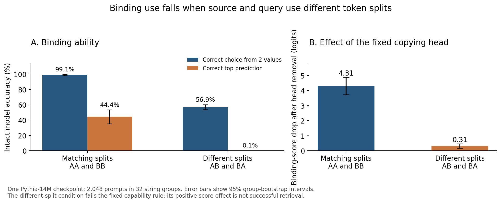

# Same text, different token splits: a limit on copying-head transfer

**Date:** 13 October 2026  
**Status:** AI-authored experiment with separate AI review. No human peer review.  
**Model:** one pinned Pythia-14M checkpoint.  
**Public plan/code lock:** [`c6ff9cb1405e6a65fe161c2f4cb471d51016bf4c`](https://github.com/gavenren/mechanistic-interpretability-research/tree/c6ff9cb1405e6a65fe161c2f4cb471d51016bf4c/studies/2026-10-13-segmentation-transfer).

## Abstract

A model can receive the same text as different token sequences. We test whether a copying head keeps its role when a repeated key uses different token splits in the source and query. We use two supplied string-to-value bindings in Pythia-14M. Each key has two disjoint two-token encodings. The prompt bytes, length, and positions stay fixed across four encoding conditions. When source and query use the same split, the model chooses the correct value over the other supplied value in 99.1% of cases. When their splits differ, this falls to 56.9%. Correct top predictions across the full vocabulary fall from 44.4% to 0.1%. Removing the final-query output of a previously selected head reduces the mismatched binding score by 0.313 logits. Its interval is positive, but the fixed capability gate fails. This is evidence of a small score response under failed transfer, not successful string retrieval. The result limits the scope of the earlier head description in one small model and one constructed task.

## 1. Research question

A common copying pattern is to find a previous occurrence of a token and predict what followed it. This can support a supplied binding such as a key followed by a value. However, text identity and token identity are different. Two token sequences can decode to the same string while sharing no token IDs.

We ask whether a previously identified copying head contributes when the source key and query have the same text but different token splits. We separate two questions. First, does the model use the supplied binding? Second, does removal of the fixed head reduce that use? A positive score effect alone cannot establish successful retrieval.

This study follows the repository's [copy-routing study](../2026-10-13-copy-routing/paper.md). That study identified layer 3, head 1 on single-token keys. Here we fix that head before collecting outputs. We do not select a new head that works better on the new task.

## 2. Relation to earlier work

Retokenization is an established way to test a model while keeping the text bytes fixed. Jain, Day, and Can study its effects on representations and behavior. Geh and colleagues study information in noncanonical tokenizations. [Jain et al.](https://arxiv.org/abs/2606.15521v1); [Geh et al.](https://aclanthology.org/2024.emnlp-main.230/).

Causal studies also show how models combine token pieces. Yang and colleagues test word recovery through subspace removal and attention masking. Busigin and Pinter separate attention transport from MLP composition through controlled patches. Their work includes larger Pythia models. Our experiment does not introduce word recovery or a new detokenization mechanism. [Yang et al.](https://arxiv.org/abs/2603.10771v2); [Busigin and Pinter](https://arxiv.org/html/2606.08562v2).

Our contribution is a small transfer test. It uses balanced supplied bindings, disjoint source/query encodings, equal token counts, and one head selected from earlier evidence. The [source record](sources.md) states the overlap. The search does not prove priority.

## 3. Method

### Model and fixed inputs

We use `EleutherAI/pythia-14m` at revision `cf967c0a9a04383db6f7b1108d86b2962634b4ac`. The model has six layers and four attention heads per layer. The runner verifies six model-file hashes. It uses float32, the stock eager-attention product, and two CPU threads. There is no training.

The key pool follows a fixed tokenizer rule. Each key is a canonical single token that decodes to one leading space and 5–12 lower-case ASCII letters. It must also have at least two exact two-token encodings. Split A uses the earliest valid character cut; split B uses the latest. All four subtoken IDs must differ. We exclude the earlier study's key/value pool and form 32 key pairs with no subtoken overlap between the two keys. Values and fillers also exclude the selected subtoken IDs.

The selected strings include word parts. We call them strings rather than assume that each is an English word. The tokenizer check found 10,051 eligible candidates after the old-pool exclusion. No model output was used to choose strings or pairs.

Each group has two keys, K and L, and two single-token values, B and D. We test both assignments, K→B/L→D and K→D/L→B. We also test both source orders, both queries, and gaps of zero or eight filler tokens after each source pair. These controls reduce explanations based on a fixed key–value association or a preference for the most recent value.

### Four encoding conditions

Source keys share one encoding setting. The query has an independent setting. This gives AA, AB, BA, and BB. AA and BB have matching splits. AB and BA have different splits.

For each binding, order, gap, and query, all four prompts decode to identical bytes. Their lengths are 9 or 25 tokens. The final readout index stays fixed. The final token ID changes with the query split; that change is part of the input-encoding test. We add no delimiter.

In AB and BA, the query shares no token ID with either source key. There are 2,048 split prompts, with 512 in each cell. We retain all of them. We also run 512 canonical one-token references. Those references have different lengths and positions. They are separate capability checks, not a matched causal comparison.

### Head intervention and measurements

We remove only layer 3, head 1's final-query output, immediately before the shared output projection. At the edited layer, all attention weights, earlier query outputs, and other heads remain exact. Later layers run normally, and their attention can change. This is one component ablation. It is not a removal of a pure semantic variable.

The binding score S is the correct supplied value's logit minus the other supplied value's logit. A logit is a model score before conversion to probabilities. The head effect E is S before removal minus S after removal. Positive E means that head removal lowers the binding score.

The two primary estimates are S and E on AB/BA prompts. The fixed primary score pattern requires positive lower 95% bounds for both. A separate capability rule requires at least 75% two-answer accuracy, at least 10% full-vocabulary top-1 accuracy, and a positive lower bound for S. This rule controls interpretation. It never removes cases.

We use 10,000 bootstrap resamples of the 32 complete groups. All prompt variants and paired interventions stay together. The intervals describe variation across these groups, not across all models or language tasks. The complete [analysis plan](analysis-plan.md) was published before the run.

## 4. Results

### Binding ability did not transfer across token splits

| Encoding relation | Cases | Correct value over the other value | Correct top prediction in the full vocabulary | Mean binding score |
| --- | ---: | ---: | ---: | ---: |
| Matching: AA/BB | 1,024 | 1,015 / 1,024 (99.12%) | 455 / 1,024 (44.43%) | 7.148 |
| Different: AB/BA | 1,024 | 583 / 1,024 (56.93%) | 1 / 1,024 (0.10%) | 0.461 |
| Canonical reference | 512 | 500 / 512 (97.66%) | 145 / 512 (28.32%) | 6.305 |

The two mismatched directions both perform poorly. AB has 56.25% two-answer accuracy and one correct full-vocabulary prediction. BA has 57.62% two-answer accuracy and no correct full-vocabulary prediction. Thus the result is not confined to one direction of the split change.

The pattern also appears at both gap lengths. Mismatched prompts have 284 correct two-answer choices out of 512 at gap zero, and 299 out of 512 at gap eight. They have zero and one correct full-vocabulary predictions, respectively. Matching prompts have 507 and 508 correct two-answer choices in those same gap conditions.

The canonical reference shows that the supplied-binding task is workable with the ordinary single-token keys. It does not establish that a two-token encoding is better than a one-token encoding: those references have different lengths and positions.

### A positive head effect remains, but the capability gate fails

| Measure | Mean | 95% group-bootstrap interval |
| --- | ---: | ---: |
| Mismatched intact binding score S | 0.461 | [0.269, 0.655] |
| Mismatched head-removal effect E | 0.313 | [0.166, 0.462] |
| Matching head-removal effect E | 4.306 | [3.723, 4.884] |
| Matching minus mismatched head effect | 3.993 | [3.392, 4.585] |

The primary score conjunction passes. The capability gate fails on both accuracy thresholds. We therefore describe the mismatched result as a small score response in a condition with limited task ability. We do not describe it as successful retrieval of the string's binding.

After head removal, mismatched two-answer accuracy is 51.95%, and no target is the top full-vocabulary prediction. The mean binding score is 0.148. On matching prompts, head removal lowers two-answer accuracy to 86.33% and full-vocabulary accuracy to 1.66%. This large effect confirms the fixed head's importance in the matching condition. It does not establish that the head acts alone.

The planned secondary contrast also shows a large loss of head effect across encodings. However, the model's intact behavior changes at the same time. This is not evidence for different internal causes at equal behavioral performance.

## 5. Verification

The locked run completed in 9.56 seconds. It saved all 2,048 split cases and 512 canonical references. It used no retries, test filtering, head search, or plan changes.

Every scientific no-op check had zero all-vocabulary logit error. The ablated head vector was exactly zero. At the edited layer, untouched head outputs and attention weights stayed exact. Future attention was zero. All byte-equality and token-overlap checks passed. Dummy checks also confirmed that final-only output projection matched the full projection.

The result files contain target probabilities and ranks, complete per-prompt score records, selected-head attention rows, group summaries, bootstrap results, per-batch control records, and a file-hash manifest. A separate AI audit replayed all 4,608 intact, ablated, and canonical forward examples through an independent implementation of the head edit. All saved target logits, rankings, recorded float32 probabilities, attention rows, head norms, table formulas, and bootstrap estimates matched exactly. The [review](reviews/independent-review.md) and [final receipt](reviews/independent-audit-final.json) state the scope.

An added audit check converted the same float32 logits to probabilities using float64 softmax. It failed its original probability tolerance. The [failed receipt](reviews/independent-audit.json) is retained. The maximum difference in this diagnostic was 0.0000772 probability units. The final audit passed by reproducing the recorded float32 calculation; it did not make the float64 check pass or change its tolerance. The probability records are specific to the locked numerical calculation. The main results use logits and rankings, which matched exactly.

## 6. What this result means

In this checkpoint, a strong head description on repeated tokens transfers poorly to repeated text with disjoint token splits. The same visible string is not enough to preserve the tested binding behavior.

This does not show that the model never reconstructs strings. It also does not show that a positive effect requires whole-string reconstruction. Similar fragment embeddings, context features, and other model paths can support a partial match even when token IDs differ. Our ablation does not separate those possibilities.

The result applies to a small model, artificial two-pair prompts, and two extreme valid splits of selected strings. Both tested encodings are noncanonical. Larger models, natural multi-token words, other split rules, or other tasks may behave differently. The fixed head was selected in an earlier task, and other components may contribute here.

The practical lesson is limited but useful: a copying head's role should be tested under the encoding changes to which its explanation is meant to apply. A small positive causal score is insufficient when the model rarely produces the requested value. Capability checks and all failed cases must remain part of that test.
