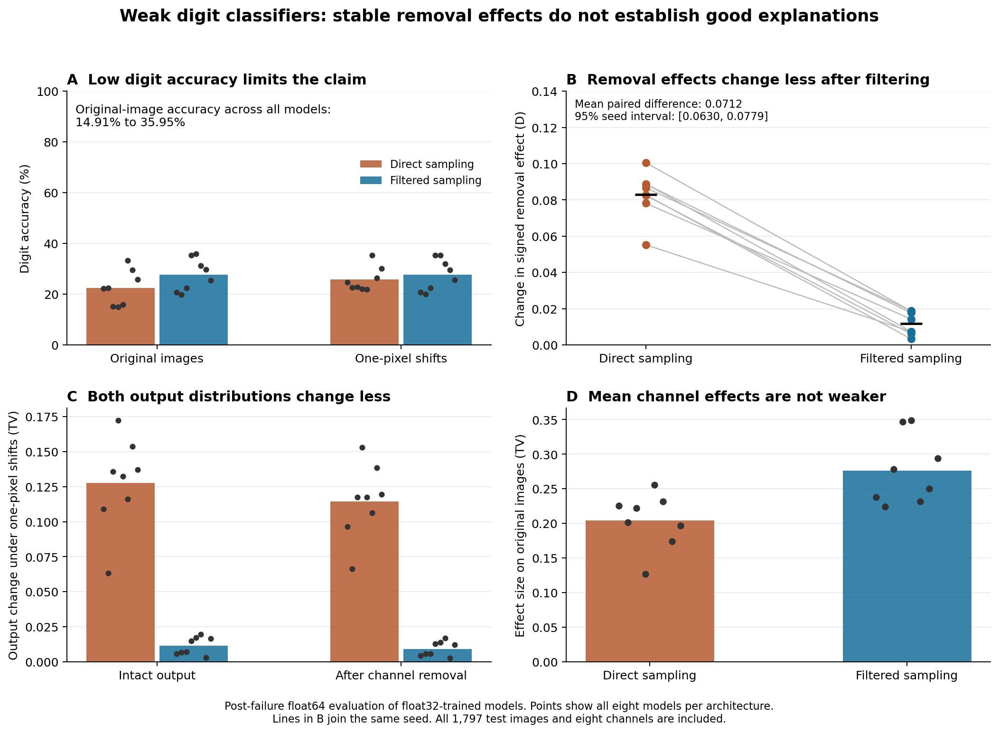

# Image shifts and channel removal in weak digit classifiers

**Date:** 13 October 2026  
**Status:** Completed post-failure numerical follow-up. The original float32 primary comparison is incomplete. AI-written research with a separate AI audit. No human peer review is claimed.  
**Public plans:** [original lock](https://github.com/gavenren/mechanistic-interpretability-research/commit/c406a08091cbc74caef1a1c4690aa29482667e0a); [failed record and diagnostic lock](https://github.com/gavenren/mechanistic-interpretability-research/commit/5d7a88d9e79d974f7e320359039e11e813d20b15); [follow-up lock](https://github.com/gavenren/mechanistic-interpretability-research/commit/782dc2c8d73a3fa9e67a03c8cbd394a5548d9bf9).

## Abstract

We studied how one-pixel image shifts change the output effect of removing an internal channel. The sixteen trained digit classifiers were weak: intact accuracy on the original test images ranged from **14.91% to 35.95%**. Thus, this study measures the stability of edits in weak classifiers. It does not establish faithful digit mechanisms or better explanations.

We compared direct downsampling with a known low-pass filter before downsampling, using eight paired training seeds. All 1,797 UCI test images and all eight first-layer channels were included. The original float32 experiment stopped when a structural control failed. A fixed diagnostic reproduced that failure. A separately locked follow-up kept float32 training but evaluated the same planned model panel in float64. It reused five completed checkpoints and trained the eleven missing models without changing their schedules.

In this follow-up, mean change in the signed channel-removal effect was **0.08294** for direct sampling and **0.01177** for filtered sampling. The paired difference was **0.07117**, with a conditional seed interval of **[0.06304, 0.07786]**. All eight paired differences were positive. The filtered models also had more stable intact and edited output distributions. Their mean removal effects were larger, so uniformly weaker edits cannot explain the result. But the two procedures learned different weights and had different task performance. The evidence supports lower absolute effect change in this fixed comparison, not a claim about semantic units.

## 1. Question and prior work

A small image movement can change a convolutional model's answer. It can also change what happens when a researcher removes part of the model. These are related questions, but their measurements differ. We ask whether a known filter that reduces output change also reduces change in the full output effect of removing a channel.

[Zhang's anti-aliasing work](https://proceedings.mlr.press/v97/zhang19a.html) already studies low-pass filters before downsampling and their effects on shift stability. [Ablation-CAM](https://openaccess.thecvf.com/content_WACV_2020/html/Desai_Ablation-CAM_Visual_Explanations_for_Deep_Convolutional_Network_via_Gradient-free_Localization_WACV_2020_paper.html) already uses channel removal for visual explanations. [Ahmad and colleagues](https://arxiv.org/abs/2305.08950) study the stability of causal graphs and explanations under intervention changes and image noise.

Our contribution is a small, fixed empirical comparison. We measure all signed output-effect vectors under exact integer shifts, report task ability and effect size, and test known structural controls. We do not introduce a new filter or attribution method. The [source record](sources.md) gives the inspected scope. The focused search does not prove novelty.

## 2. Fixed data, models, and edit

We used the original [UCI Optical Recognition of Handwritten Digits](https://doi.org/10.24432/C50P49) split. It has 3,823 training images from 30 writers and 1,797 test images from 13 different writers. Each image is an 8×8 grid of counts from 0 to 16. We divided the counts by 16 and put the grid in the centre of a zero 16×16 canvas. The numeric files do not contain individual writer IDs. The attributed data copies, exact hashes, and licence are in [data/README.md](data/README.md).

Each network has three 3×3 convolution layers, with 8, 16, and 32 channels. Each convolution has a bias, circular padding, and a ReLU. Two downsampling stages follow the first two ReLUs. Global spatial averaging and a linear map produce ten digit logits. There is no normalization or dropout.

The direct model takes every second row and column. The filtered model first applies the fixed 3×3 binomial filter formed from `[1,2,1]` in each axis, normalized to sum to one. It then takes the same rows and columns. This is a comparison of two **training procedures**. It does not test insertion of a filter into one fixed trained model.

For each seed from 0 through 7, the two architectures began with identical trainable parameter bytes. They received the same saved batch orders and shifts. Each model trained for ten full epochs, or 300 updates, using Adam at learning rate 0.001 and batches of 128. Training shifts were integer movements from −2 through +2 in each axis. All training used float32. The [original plan](analysis-plan.md) fixes the initialization, optimizer details, schedules, and package versions. No seed was replaced and no training was extended after results.

The edit sets one complete first-ReLU channel to zero before the first downsampling stage. The rest of the network then runs normally. We tested all eight channels. We compared each channel with itself across shifts within the same model. Equal initial weights do not establish the same channel meaning across the two trained architectures.

Every test image was evaluated unchanged and after a one-pixel movement up, down, left, and right. The intact model and all eight edits were evaluated at every position. No image or channel was removed because of its answer or effect size.

## 3. What the score measures

Let `p(x)` be the ten-class probability vector, and let `p_c(x)` be the vector after channel `c` is removed. Define the signed effect as `e_c(x) = p(x) − p_c(x)`.

The model's score `D` is the mean of `0.5 × sum(abs(e_c(shift(x)) − e_c(x)))` over all images, eight channels, and four one-pixel shifts. It measures absolute change in the signed edit effect. Its range is zero to two. Because a signed effect is not a probability distribution, `D` is not itself total variation between probabilities.

The sole primary comparison is `D_direct − D_filtered`, paired within each seed. The fixed interval uses 10,000 resamples of the eight whole seed pairs. It is conditional on this data split and training design. Images, channels, and shifts are not independent model replications. This interval does not describe uncertainty across writers, datasets, or architectures.

We also report total variation, or TV, between the intact output distributions before and after a shift. TV is half the sum of absolute probability changes. We report the same measure after removal, plus the size of the removal effect itself. The triangle inequality gives a useful bound: the change in a removal effect cannot exceed the sum of the intact-output change and the edited-output change. This is established algebra. Lower `D` alone does not prove more stable semantic features.

## 4. Original failure and new numerical condition

The original public plan used float32 evaluation. It stopped at a required four-pixel shift control in seed 2 direct. A maximum logit error of **0.0000214577** exceeded the fixed **0.0000200000** limit. Four model evaluations were complete. The fifth model had completed all 300 training updates. The original partial outputs and [failure receipt](results/failure.json) remain unchanged. Its primary comparison is incomplete, and its failed check remains failed.

The control has an exact mathematical basis. With two stride-two stages, circular operations, whole-channel removal, and global averaging, a four-pixel shift should leave outputs unchanged. Finite precision can affect its numerical implementation.

A separately planned diagnostic tested the exact failed 128-image batch with the same weights. An independent hook reproduced the saved float32 logits and the failure exactly. With float64, the hook's shift error was **8.88e-16**. A second implementation, using explicit convolution windows, had zero float64 shift error. The two float64 implementations differed by at most **1.78e-15**. The [diagnostic record](diagnostics/failure-batch/receipt.json) is consistent with float32 numerical error. It does not identify one operation as the sole cause.

We then published a [follow-up plan](followup-plan.md) before running a new numerical condition. It retained all sixteen models, all seeds, all training rules, and all scores. It reused five completed float32 checkpoints, including seed 2 direct, after exact hash and training-record checks. It trained only the eleven missing models. It converted saved float32 weights and test inputs to float64 for evaluation and saved float64 logits. Probabilities use a specified NumPy float64 softmax.

The new logit and feature tolerance was fixed at 1e-10. Exact-zero edit and no-op checks stayed exact. This is a post-failure follow-up, not completion of the original float32 test. Float64 evaluates a different numerical computation. The earlier tolerance was not raised, and no original record was replaced.

## 5. Follow-up results

### Digit recognition was poor

Mean original-image accuracy was **22.44%** for direct sampling and **27.62%** for filtered sampling. No model exceeded 35.95%. These low values are a central limit. A stable change in a weak classifier does not validate an explanation of competent digit recognition.

| Measure, mean over eight models | Direct | Filtered |
|---|---:|---:|
| Original-image accuracy | 22.44% | 27.62% |
| One-pixel-shift accuracy | 25.74% | 27.67% |
| Same top prediction after a one-pixel shift | 47.77% | 93.65% |
| Signed effect change, `D` | 0.08294 | 0.01177 |
| Intact output shift TV | 0.12744 | 0.01139 |
| Edited output shift TV | 0.11440 | 0.00931 |
| Sum of the two shift TV terms | 0.24184 | 0.02070 |
| Removal effect size on original images | 0.20443 | 0.27658 |
| Removal effect size over all five positions | 0.20647 | 0.27702 |

The primary difference was **0.07117**, with the fixed 95% seed interval **[0.06304, 0.07786]**. Every pair favoured lower absolute effect change under the filtered training procedure.

| Seed | Direct `D` | Filtered `D` | Difference |
|---|---:|---:|---:|
| 0 | 0.08250 | 0.00621 | 0.07629 |
| 1 | 0.05526 | 0.00741 | 0.04786 |
| 2 | 0.08886 | 0.00747 | 0.08139 |
| 3 | 0.07816 | 0.01430 | 0.06386 |
| 4 | 0.10055 | 0.01874 | 0.08181 |
| 5 | 0.08668 | 0.01890 | 0.06778 |
| 6 | 0.08275 | 0.00339 | 0.07936 |
| 7 | 0.08873 | 0.01772 | 0.07102 |

### Lower change did not come with lower mean removal strength

Mean removal effects were larger in the filtered models. Thus, a reduction in mean channel impact is not the sole explanation for their lower `D`. However, the two procedures learned different weights and output distributions. This comparison does not isolate filtering from all changes to learning, confidence, or feature use.

The intact and edited output distributions both moved less under shifts in filtered models. Their triangle-bound sum was also much lower. This connects the measured stability to ordinary output stability. It does not establish that any channel keeps a particular human meaning.

The fixed secondary subgroup kept images classified correctly at all five positions. Its mean size was 139.5 images in direct models and 455.6 in filtered models. Its mean `D` was 0.06912 and 0.01151, respectively. Membership differs by model. This is a descriptive result, not a matched comparison of the same images. The full test set remains primary.

All model, channel, digit, and shift values are retained in the [complete summaries](results-float64/model-summaries.json) and [CSV tables](tables/model-summaries.csv). The figure shows all seed-level values for its measures.

*Figure 1. The low task accuracy limits interpretation. A shows digit accuracy. B shows the planned effect-change score, with each line joining one seed pair. C shows changes in intact and edited probability distributions. D shows mean removal strength on original images. Points represent models; bars or black marks show means. The figure uses the post-failure float64 condition. It does not establish explanation quality.*

## 6. Checks, audit, and cost

All **45,632** follow-up control rows passed. The largest four-pixel logit error was **2.66e-15**, below 1e-10. First-feature shift errors, no-op errors, removed-channel values, and changes to untouched channels at the edit site were zero. The largest probability-sum error was 6.66e-16. The triangle inequality held within 1.11e-16. These checks cover every fixed model and test case. They do not erase the earlier float32 failure.

A [separate audit](reviews/independent-audit.json) rebuilt the model with a ReLU hook and replayed all **12,938,400 saved logit values**. They matched exactly. It replayed all 45,632 controls, rebuilt all scores and the seed interval, and checked all eight schedules, five reused checkpoints, and 4,800 training records. It did not repeat training. The largest difference between control records was 2.78e-17.

The failed run took 57.50 seconds and included 1,500 updates. The exact-batch diagnostic took 0.31 seconds. The follow-up took 184.84 seconds on two CPU threads, with 3,300 new updates, 23,940 full model calls, and 2,893,202 forwarded examples. Across the study, each of the sixteen models was trained once: 4,800 updates and 611,680 training examples. The independent follow-up audit took 123.15 seconds and replayed 20,640 full evaluation calls. Dummy tests and review added further work. These are measured local elapsed times, not general cost estimates.

The public locks fix the relevant plans and runners. Each run checked locked bytes and hashes. Separate manifests cover the [failed run](results/manifest.json), [diagnostic](diagnostics/failure-batch/manifest.json), and [follow-up](results-float64/manifest.json). The [README](README.md) gives reproduction steps that preserve published outputs.

## 7. Limits and conclusion

These are weak digit classifiers. The study does not establish faithful digit mechanisms, stable semantic units, or better explanation quality. It shows that, in this fixed post-failure comparison, a filtered training procedure produces smaller changes in measured channel-removal effects under one-pixel shifts.

The scope is small: count images, two CNN procedures, eight seed pairs, circular padding, and one writer-separated split. Removing an entire channel can produce an internal state that natural inputs do not create. Shared initialization does not imply shared channel meaning. The seed interval does not cover other datasets or tasks. Low task accuracy remains a scientific limit even though the new numerical controls pass.

A later study could use a separately planned model that reaches strong task accuracy. It could then test whether this same stability measure helps identify useful mechanisms. That would require new evidence. We did not alter the fixed training to obtain that result here.

## Research record

- [Original plan](analysis-plan.md), [original runner](code/run.py), and [failed outputs](results/).
- [Diagnostic plan](reviews/failure-diagnostic-plan.md), [diagnostic code](code/failure_diagnostic.py), and [interpretation](reviews/failure-diagnostic-interpretation.md).
- [Follow-up plan](followup-plan.md), [follow-up runner](code/run_float64.py), and [pre-run review](reviews/followup-pre-run-review.md).
- [Raw logits and checkpoints](results-float64/), [report generator](code/plot_followup.py), and [reproduction steps](README.md).
- [Independent audit code](code/independent_audit.py), [audit receipt](reviews/independent-audit.json), and [checked sources](sources.md).

The paper, code, and reviews are AI-authored. There has been no human peer review. The record supports a bounded research result, not an established discovery.
