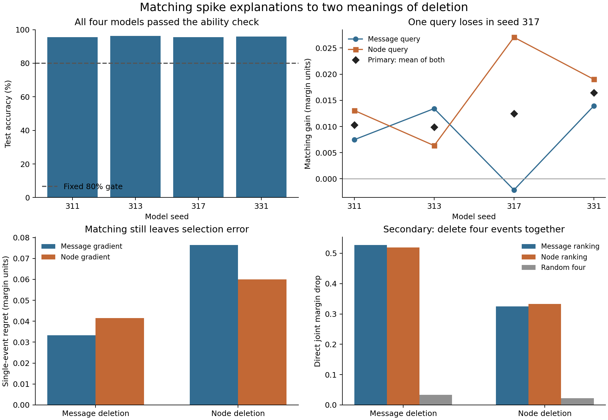

# Matching spike explanations to two meanings of deletion

13 October 2026. AI-authored research report. Separate AI checks cover the design, saved results, and report. No human peer review is claimed.

The [public plan and code lock](https://github.com/gavenren/mechanistic-interpretability-research/tree/b3d97c132b8162dd2cb21bce031820fd0f078065/studies/2026-10-13-spike-reset-queries) preceded all study model calls. The [fixed plan](analysis-plan.md), [source record](sources.md), [input ledger](inputs.json), and [reproduction guide](README.md) give the full record.

## Abstract

A spike in a neural network can send a message and reset its own voltage. Removing only the message has a different meaning from removing both paths. We test whether a gradient that matches the specified deletion selects a spike with a larger exact effect. Four small spiking digit classifiers reached 95.55–96.33% test accuracy. For each model, we used the same fixed panel of 120 images and all 32 first-layer events at the fourth update. The primary matching gain was 0.01227 output-margin units. All four seed means were positive. A descriptive interval from resampling the four seeds was [0.01008, 0.01492]. The gain was not uniform: one seed lost under message deletion. Matching also left substantial selection error and did not consistently improve effect-sign accuracy. The result supports a narrow procedure: define which spike paths an edit changes, then test an explanation against that exact edit. It does not establish a useful real-world effect, a complete mechanism, or a general advantage for reset-aware gradients.

## 1. Why the deletion definition matters

In the tested network, a spike has two immediate uses. It sends a value to the next layer. It also subtracts one unit from its own voltage. This reset can change later spikes. A command to “delete a spike” is incomplete unless it states which uses change.

We compare two precise operations. **Message deletion** removes the selected outgoing message but keeps the original reset. **Node deletion** removes both the message and the reset spike. Both operations set the immediate outgoing message to zero. They can produce different future states because only the second operation changes the local reset. Future states are computed freely; the experiment does not supply saved future states to either branch.

Gradient attribution, spike deletion, and reset-path choices are established ideas. Bitar, Rosales, and Paulitsch study [gradient attribution and deletion tests in spiking networks](https://doi.org/10.3389/fnins.2023.1153999). Kim, Kim, and Kim compare [activation, timing, and reset paths](https://papers.nips.cc/paper_files/paper/2020/file/e2e5096d574976e8f115a8f1e0ffb52b-Paper.pdf). Gygax and Zenke examine the [basis and limits of surrogate gradients, including reset derivatives](https://arxiv.org/html/2404.14964v3). Temporal explanations also appear in [Temporal Spike Attribution](https://arxiv.org/html/2311.02110) and [EventRPG](https://arxiv.org/html/2403.09274v1).

Our contribution is a finite comparison of two local explanation graphs against two exact internal deletions, with trained models and complete saved traces. We change the selected event's immediate reset edge only. Both explanation graphs keep all later reset derivatives. We do not introduce reset-path analysis or claim that this test is the first such test.

## 2. Fixed experiment

### Models and inputs

We used the original UCI optdigits split: 3,823 training images and 1,797 test images. Each image has 64 values, divided by 16. The two hidden layers each have 32 spiking units. A linear readout gives ten class scores. There are 3,466 trainable parameters. The same image supplies input current for eight updates. Voltage decays by a factor of 0.9. A voltage of at least one produces a spike and a subtractive reset of one. At most one spike occurs per unit per update. The output uses the mean second-layer spike rate over the eight updates.

Each of four fixed seeds received 40 epochs and 1,200 Adam updates, with no tuning or early stopping. The binary forward computation used float64 on two CPU threads. Training used the fixed surrogate derivative `1 / (1 + 10*abs(u-1))^2`, with all reset derivatives present. A surrogate derivative is a smooth backward rule for a hard threshold; it is not an exact derivative of the discrete forward model. The [plan](analysis-plan.md) fixes every optimizer and model setting.

The explanation panel contains the first 12 test images for each digit, sorted by file row. Its 120 rows all lie between row 0 and row 127. This is a small file-order panel, not a random sample. No model output selected an image. We kept all images and all four seeds. Each model had to reach 80% accuracy on the full test split for the fixed ability check.

### Explanation graphs and exact scores

All 32 first-layer events at the fourth update were candidates. Inactive events remained eligible. For each image, we fixed the intact model's highest-scoring class and runner-up. Their score difference is the **margin**. The original pair of classes remained fixed after every edit. Margin units are model output-score units, not probability points or accuracy points.

For the message gradient, an independent vector with the original spike values supplied only the outgoing messages. For the node gradient, it supplied both outgoing messages and the immediate reset. These choices gave identical forward values. All future surrogate and reset paths stayed active in both graphs. The predicted deletion effect was the gradient of the margin times the original binary spike. Each rule selected the largest signed predicted drop, with unit index used to resolve ties. We did not rank by absolute value.

We then deleted every candidate under each exact meaning. Its exact effect was the intact margin minus the edited margin. For one query and one selector, **regret** was the best exact effect among the 32 candidates minus the selected event's effect. A regret of zero means that the rule selected a best candidate for this margin. It does not mean that the candidate explains the classification in full.

The sole primary score was the average regret with the two mismatched rules minus the average regret with the two matched rules. Positive values favor matching. The best-candidate terms cancel. Thus, the score is also the mean of two gains: the node selector's advantage for node deletion and the message selector's advantage for message deletion. We report both gains because their mean can hide a loss.

Each model's score is the mean over 120 images. The final score weights the four models equally. The interval uses 10,000 whole-seed bootstrap samples. It describes this small fixed panel; it does not cover other data, architectures, or training choices. The rule “mean greater than zero” was fixed before results. Passing that rule alone is not evidence of practical value.

## 3. Results

*Figure 1. All models passed the ability check. Matching helped the primary mean for each seed, but one message-query gain was negative. The lower panels show absolute regret and the separate four-event test. Bars are means across the four fixed models. The lines join seed labels for display; seeds do not form a measured trend.*

### A small gain, with one directional loss

All models exceeded the 80% ability threshold. Mean full-test accuracy was 95.84%; mean explanation-panel accuracy was 93.13%.

| Seed | Full-test accuracy | Panel accuracy | Message-query gain | Node-query gain | Primary mean |
|---|---:|---:|---:|---:|---:|
| 311 | 95.60% | 94.17% | 0.00749 | 0.01306 | 0.01027 |
| 313 | 96.33% | 95.83% | 0.01343 | 0.00635 | 0.00989 |
| 317 | 95.55% | 90.83% | −0.00212 | 0.02705 | 0.01246 |
| 331 | 95.88% | 91.67% | 0.01392 | 0.01902 | 0.01647 |
| Equal-seed mean | 95.84% | 93.13% | 0.00818 | 0.01637 | **0.01227** |

The primary interval was **[0.01008, 0.01492]** margin units. Every seed had a positive primary score, but seed 317 favored the node gradient even for message deletion. Of the 480 model–image cases, 57 had a positive primary score, eight had a negative score, and 415 had zero. The two selectors chose the same unit in 378 cases, or 78.75%. Some different selections also had equal exact effects.

For scale, the mean intact margin was 4.43305. That is context for these model units, not a threshold for useful explanation. The experiment does not measure a downstream user benefit. On the correct-at-baseline subset, the equal-seed primary mean was 0.01149. That secondary subset contained 109–115 images per seed and differed across seeds.

### Matching leaves error and does not ensure the right sign

The mean regret across matched cells was 0.04671; across mismatched cells it was 0.05899. The full table shows the remaining error.

| Exact deletion meaning | Message gradient: regret | Node gradient: regret | Message gradient: selected effect | Node gradient: selected effect |
|---|---:|---:|---:|---:|
| Message | **0.03337** | 0.04155 | 0.16895 | 0.16077 |
| Node | 0.07642 | **0.06005** | 0.09000 | 0.10637 |

The primary result concerns the selected event, not all effect predictions. Among active candidates with nonzero predicted and exact effects, sign errors remained common. We pool eligible event counts for this descriptive table; the seed-level fractions are also saved.

| Exact deletion meaning | Message gradient: wrong signs | Node gradient: wrong signs |
|---|---:|---:|
| Message | 902 / 4,310 (20.93%) | 910 / 4,310 (21.11%) |
| Node | 948 / 3,458 (27.41%) | 958 / 3,458 (27.70%) |

For node deletion, the matching gradient had a slightly higher sign-error fraction. Thus, the selection gain does not support a claim of improved sign accuracy. The two exact queries differed by 0.01673 margin units on average in absolute value across all candidates, including inactive ones.

There were 6,227 active events among 15,360 model–image–unit candidates, or 12.97 active events per case. At least one positive exact effect existed in 417 of 480 cases for message deletion and 407 for node deletion. Zero exact effects occurred for 11,050 candidates under message deletion and 11,902 under node deletion. These zeros, including all inactive nodes, remained in the selection task and primary score.

### Four-event deletion gives a separate, limited result

The secondary test deleted four events together. Each gradient selected its top four. A fixed random set supplied a reference. We measured the joint effect directly; we did not add singleton effects.

| Exact deletion meaning | Message ranking | Node ranking | Random four |
|---|---:|---:|---:|
| Message | 0.52723 | 0.51906 | 0.03380 |
| Node | 0.32509 | 0.33248 | 0.02205 |

Matching had a larger mean joint effect for each query. It was not better in every seed: seed 313 lost under node deletion, and seed 331 lost under message deletion. We did not search all four-event sets. These are measured joint effects, not regret relative to the best joint edit.

## 4. Verification and cost

All 1,688 planned controls passed. Both explanation graphs and all self replacements reproduced the intact forward traces exactly. Prefixes and untouched values at the edit site remained exact. Inactive edits were no-ops. Message deletion left the entire first-layer trajectory exact. The independent tangent check differed from autograd by at most 1.67×10⁻¹⁶. The final second-layer linear-readout check differed by at most 2.28×10⁻¹⁵. Both were below the fixed 10⁻¹⁰ tolerance.

A [separate audit](reviews/independent-audit.json) used an explicit hard-spike recurrence and a manual reverse gradient calculation. It did not import the study runner or use autograd for its gradient check. It reproduced all 431,880 saved logits and 27,648,000 binary trace values exactly. Baseline and leaf-graph voltages also matched exactly. Gradient error was at most 5.55×10⁻¹⁷. All selectors, effects, tables, ability checks, and the primary interval matched. The audit checked 4,800 training records and the saved schedules, but **did not repeat training**.

The scientific run took 16.89 seconds on this host. It used 4,800 training updates, 5,160 full forward calls, and 654,868 eight-step forwarded examples, including training. The audit took 3.91 seconds, with 360 full calls and 43,188 examples. Dummy engineering tests and report creation are separate from those totals. No paid compute or GPU was used. These timings describe this host and run.

## 5. What the result supports

An internal spike edit must state whether it removes only the outgoing message or also the reset. In this fixed test, matching the local gradient graph to that choice reduced average single-event selection regret. A matched graph still gave wrong signs and missed the best event. The exact deletion measurements are therefore part of the evidence, not a check that gradients can replace.

The scope is narrow: four trained models, one dataset, a small file-order panel, one layer and update, 32 candidates, one surrogate, and one score. Good digit accuracy does not establish a complete or semantic account of these models. There is no test of biological neurons, language models, other spike codes, robustness under distribution change, or a real-world intervention. The four-seed interval is too limited to support broad reliability claims. Future work should fix new tasks and intervention sites before testing them, and should retain both deletion meanings, absolute regret, and sign errors.

The complete primary sources and exact overlap limits are in the [source record](sources.md). Raw outputs, trained weights, traces, schedules, report tables, and audit code are part of this study. See the [README](README.md) for fresh-path reproduction commands.
