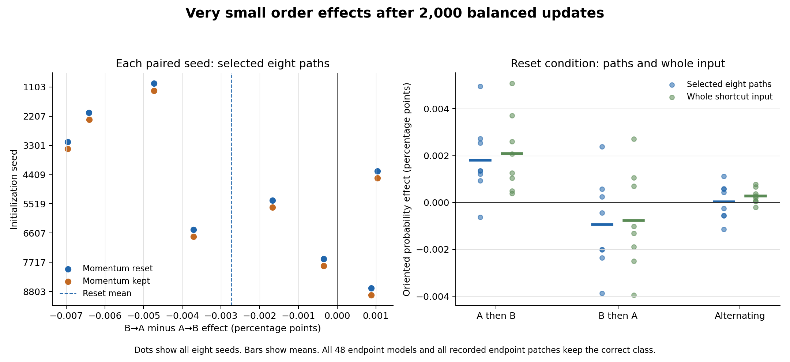

# Tiny order effects after balanced retraining

**A controlled test of internal shortcut paths in small neural networks**

13 October 2026. AI-authored research report with a separate AI audit. No human peer review has occurred.

## Abstract

Training order can change what a network learns. We asked whether an internal shortcut effect would remain after every network received the same balanced correction phase. Eight paired initialization seeds were trained with three orders of the same examples. Each network then received 2,000 common updates, with its momentum either kept or reset. The main contrast in a selected set of internal paths was **−0.00002737 in probability, or −0.00274 percentage points**. This is very small and opposite to the proposed direction. All 48 final models gave the correct answer on all 32 possible inputs. Every recorded final internal patch also kept the correct answer. The result shows a small order-related confidence effect in this fixed experiment. It does not show lasting decision errors, a useful shortcut circuit, or irreversible training history.

## 1. Why test order after a common correction phase?

A network can solve a training set by using a shortcut that does not hold elsewhere. Later examples can oppose that shortcut. A direct comparison of the resulting models is hard to interpret if their example counts, recent labels, or optimizer states also differ.

We controlled those factors in a small task with a complete input table. The networks saw exactly the same examples the same number of times. Each update had balanced labels. All networks then received the same balanced tail of training. We also reset momentum in one copy of each model. The question was whether order would still affect a defined internal path measurement.

This is a narrow benchmark. Training data and learning history are already established causes of changes in internal computation. [Patterning](https://proceedings.mlr.press/v306/wang26fw.html) uses data weighting to change circuit formation and algorithm choice. [Mechanistic Data Attribution](https://arxiv.org/abs/2601.21996v2) traces interpretable units to training examples. [Easing Optimization Paths](https://arxiv.org/abs/2501.02362v1) connects curriculum design with circuit learning. Our contribution is the matched-example test and its complete reproducible record.

## 2. The task and the fixed training comparison

Each input has five values, each either −1 or +1. The correct label is the product of the first two values: `y=x1*x2`. A third value, z, is the shortcut. The last two values are irrelevant to the correct answer. There are only 32 possible inputs, so we can test them all.

Regime A contains the 16 inputs where z agrees with y. Regime B contains the other 16. Each regime has equal numbers of positive and negative labels. We trained a network with two 32-unit hidden layers and 1,281 parameters. We used float64 arithmetic, exact GELU activations, binary cross-entropy, and SGD with learning rate 0.05 and momentum 0.9.

For each of eight fixed seeds, the same initial weights were used for three orders:

- **A then B:** 500 complete A batches, followed by 500 B batches.
- **B then A:** the reverse order.
- **Alternating:** 500 A/B pairs, ending with B.

Every input appeared 500 times in each prefix. At that point, we copied each model into two conditions. One retained its momentum buffers; the other set only those buffers to zero. Both then received 2,000 updates on all 32 inputs. We saved results at tail updates 0, 200, and 2,000. The last checkpoint was the primary endpoint. No seed was removed or given extra training.

The [plan and runner were locked publicly](https://github.com/gavenren/mechanistic-interpretability-research/tree/c6ff9cb1405e6a65fe161c2f4cb471d51016bf4c/studies/2026-10-13-training-order-paths) before any study model was trained or evaluated. The dummy checks used separate inputs and a separate seed.

## 3. What the internal path measurement means

We changed the shortcut input z while keeping the other four values fixed. Instead of passing that change through the whole first layer, we changed only the preactivation values of selected hidden units. The rest of the network then ran normally. This isolates routes from z into those units. It does not assume that a unit represents only the shortcut.

We ranked all 32 single-unit paths by their average absolute probability effect on 16 calibration inputs. We selected the first eight, using a fixed tie rule. We then applied them jointly to 16 different intervention contexts. The split used the two irrelevant inputs: equal nuisance values for calibration and unequal values for testing. All natural inputs were used in training. The test therefore holds out intervention contexts, not natural training inputs.

For each receiver, let q be the probability assigned to the correct class and q′ the probability after the patch. We measured:

`oriented effect = -(z*y) * (q′ - q)`.

Positive values mean that the route favors a shortcut that agrees with the label. The main comparison was the test-set mean for B then A minus that for A then B, after 2,000 tail updates with momentum reset. We also reported the same measure in logit-margin units, before conversion to probability.

The selected mask was fitted again at each checkpoint and for each model. Thus a later effect does not mean that the same units kept the same role through training. We also measured the complementary 24 paths, all 32 paths, all single paths, and eight fixed random eight-path sets. A partial route can have an effect that other routes cancel. The full input change must be examined separately.

## 4. Results

The main probability effect was small and opposite to the proposed direction. The paired mean was −0.000027367. Six seed differences were negative and two were positive. The fixed descriptive bootstrap interval was [−0.000048137, −0.000007692]. This interval resamples only the eight paired seeds. It does not support a population claim about other models or tasks.

| Seed | Main B-then-A minus A-then-B contrast, percentage points |
| --- | ---: |
| 1103 | −0.004732 |
| 2207 | −0.006411 |
| 3301 | −0.006955 |
| 4409 | +0.001043 |
| 5519 | −0.001666 |
| 6607 | −0.003713 |
| 7717 | −0.000346 |
| 8803 | +0.000886 |
| Mean | **−0.002737** |

The result is larger than the fixed numerical description threshold of `1e-8` probability. That threshold is not a claim of practical importance. The independent numerical error was about `1.33e-15`, while the measured probability difference was still very small in absolute terms.

*Figure 1. The left panel shows each paired seed difference with momentum reset or kept. The two conditions almost overlap. The right panel shows the selected paths and the complete shortcut-input change. Dots are seeds; short bars are means. All effects use percentage points, not percentages relative to a baseline.*

At the end of the common tail, all 48 models had 100% accuracy on all 32 inputs. They had also reached 100% by tail update 200. At the prefix endpoint, mean full-table accuracy was only 56.64% for A then B and 58.98% for B then A; the alternating models already had 100% accuracy. The common tail therefore corrected the observed classification errors.

The internal effects changed direction during the tail. In the reset condition, the selected-path B-then-A minus A-then-B contrast was +1.31137 at tail update 0, −0.00043634 at update 200, and −0.00002737 at update 2,000. These are three saved checkpoints, not a continuous account of the learning process. The large prefix effect is not the primary result.

### Probability and margin tell different parts of the story

The networks were highly confident at the endpoint. A change in a large correct-class margin can cause only a small change in correct-class probability. The table gives both scales, averaged over the eight reset models and held-out intervention contexts.

| Training order | Selected-path effect, percentage points | Full-input effect, percentage points | Selected-path margin effect | Full-input margin effect |
| --- | ---: | ---: | ---: | ---: |
| A then B | +0.001804 | +0.002080 | +0.6960 | +0.7952 |
| B then A | −0.000933 | −0.000774 | −0.5533 | −0.4987 |
| Alternating | +0.000026 | +0.000275 | −0.0187 | +0.0593 |

These are oriented effects, not the network's ordinary correct-class margins. Mean ordinary margins were 10.44, 10.55, and 10.74 for the three reset schedules. Mean cross-entropy was 0.00003989, 0.00003863, and 0.00002440. Equal accuracy therefore did not imply equal confidence or loss.

A descriptive check of all 66,048 recorded endpoint patched outputs found no class error. This count includes all single paths, the selected set, its complement, the full set, and the random sets, across both calibration and test contexts. It is a complete finite table, not 66,048 independent trials. The smallest correct-class margin among these patches was 7.2883.

Keeping momentum gave a main contrast of −0.000027358. The mean change caused by resetting it was −0.000000009715 in probability. Under this fixed schedule, the reset had little effect on the endpoint contrast. This does not show that optimizer state is unimportant in other training regimes.

The fixed random-mask results were mixed. Their mean test effects in the reset condition were +0.000589 percentage points for A then B, −0.000085 for B then A, and −0.000085 for alternating training. Individual mask-and-seed effects had both signs. The selected eight paths are a defined measurement result, not a unique or complete shortcut circuit.

## 5. Controls, audit, and cost

The runner completed all 120,000 planned updates in 51.54 seconds on a two-thread CPU run. It saved 176 weight and optimizer checkpoints, evaluated 144 of them, and wrote 198,144 intervention rows. All 19,344 fixed controls passed; the largest error was `1.78e-15`, below the `1e-10` bound.

The controls checked exact initial copies and reset forks, equal exposure counts, balanced labels, full-layer agreement with a real input flip, self replacement, explicit restoration of receiver values, and the known first-layer change caused by z. A real change in x1 reversed the oracle label as required. No control tolerance was changed after results.

A separate AI audit reconstructed all 144 checkpoint evaluations and all 198,144 intervention rows without importing the runner. It reproduced all selected masks and the main bootstrap interval, with a largest error of `1.33e-15`. It also checked checkpoint hashes, initial weights, optimizer forks, training-record counts, and the intact and patched accuracy claims. **It did not replay the training trajectories.** The [audit receipt](reviews/independent-audit.json) and [review](reviews/independent-review.md) state that scope. The audit took 10.16 seconds, in addition to the 51.54-second training-and-evaluation run.

## 6. What this result does and does not establish

The fixed experiment did not support the proposed positive late-order effect at the primary endpoint. It found a small effect in the other direction. That effect was present in a path measurement and in full-input confidence changes, while all final class decisions remained correct.

The common tail and reset control separate this result from unequal example counts, immediate label imbalance, and retained momentum alone. They do not prove that every model reached the same optimum. Eight seeds, one architecture, one learning rate, and one small task leave a narrow scope. The selected paths are not pure semantic units. The calibration and test split does not measure generalization to unseen natural examples. Probability saturation and different endpoint losses remain important limits.

Earlier work already studies persistent effects of early training, including [Critical Learning Periods](https://arxiv.org/abs/1711.08856) and [learning under non-stationarity](https://proceedings.mlr.press/v330/lyle26a.html). [Process-Tensor Tomography of SGD](https://arxiv.org/abs/2601.16563v1) also uses order and optimizer-state interventions. [Primacy Bias](https://proceedings.mlr.press/v162/nikishin22a.html) and [Resetting the Optimizer](https://arxiv.org/abs/2306.17833) further limit any novelty claim about reset controls. Our finite tail cannot establish permanence or a new critical period.

The useful result is the complete comparison: a strong prefix shortcut effect became a very small confidence effect after balanced retraining, without endpoint decision errors. The [README](README.md) gives reproduction commands, and [sources.md](sources.md) records the prior-work check.
